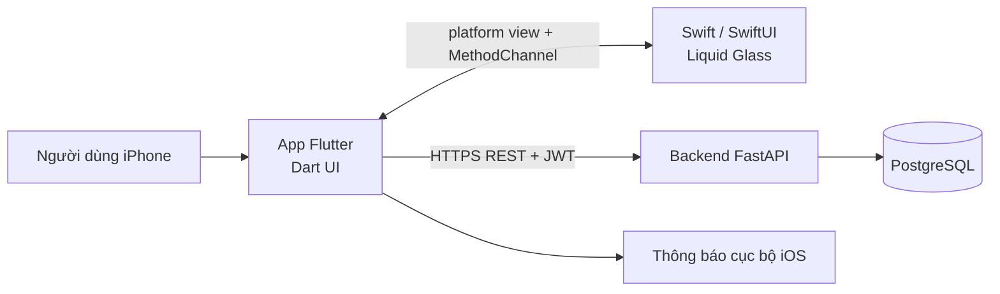

# Kiến trúc hệ thống

## Tổng quan


## Thành phần
| Thành phần | Công nghệ | Trách nhiệm |
|---|---|---|
| App mobile | Flutter (Dart), Riverpod, go_router, Dio, fl_chart | Giao diện, gọi API, biểu đồ, lưu token |
| Liquid Glass | Swift, SwiftUI `.glassEffect()` | Vẽ lớp kính lỏng native trên iOS 26+ |
| Backend | FastAPI, SQLAlchemy 2 async, Pydantic v2 | API REST, xác thực JWT, nghiệp vụ |
| CSDL | PostgreSQL 16, Alembic | Lưu dữ liệu, quản lý migration |
| Nhắc nhở | flutter_local_notifications (app), API reminders (backend) | Lưu lịch nhắc trên server, gửi thông báo cục bộ trên máy |
| Hạ tầng | Docker Compose, GitHub Actions | Chạy backend local, CI |

## Cấu trúc app Flutter
```
mobile/lib/
├── main.dart              # khởi tạo ProviderScope và MaterialApp.router
├── app/router.dart        # go_router
├── core/                  # theme.dart, api_client.dart
├── widgets/               # widget dùng chung
└── features/<tính-năng>/  # màn hình, provider, repository của từng tính năng
mobile/packages/liquid_glass/          # plugin Flutter cục bộ
├── lib/liquid_glass.dart              # widget LiquidGlass + supportsLiquidGlass()
└── ios/liquid_glass/Sources/liquid_glass/
    ├── LiquidGlassPlugin.swift        # đăng ký platform view và kênh
    ├── LiquidGlassPlatformView.swift  # UIHostingController bọc view SwiftUI
    └── LiquidGlassView.swift          # .glassEffect() (iOS 26+)
```
Dùng plugin cục bộ thay vì thêm file vào `ios/Runner` để: Flutter tự đăng ký qua `GeneratedPluginRegistrant`, không phải sửa `project.pbxproj` (dễ xung đột khi merge), và test được riêng.

## Cầu nối Flutter và Swift (Liquid Glass)
1. Dart gọi `MethodChannel('liquid_glass').invokeMethod('supportsLiquidGlass')`.
2. Nếu `true` (iOS 26+), widget `LiquidGlass` đặt `UiKitView(viewType: 'healthtrack/liquid_glass')` làm nền, rồi vẽ nội dung Flutter lên trên.
3. Phía Swift, `LiquidGlassPlugin` đăng ký `LiquidGlassViewFactory`; factory tạo `UIHostingController` chứa `LiquidGlassView`, view này dùng `.glassEffect(.regular.tint().interactive())`.
4. Nếu `false` (iOS cũ, Android, test), widget dùng `BackdropFilter` + nền trong suốt làm bản dự phòng.

Tham số truyền qua `creationParams`: `cornerRadius`, `tint` (ARGB), `interactive`.

## Phân lớp backend
`router (api/v1)` → `service (services)` → `crud` → `model (SQLAlchemy)`. Schema Pydantic ở `schemas/`.

## Bảo mật
Mật khẩu băm bcrypt; JWT access token (30 phút) + refresh token (7 ngày), lưu trong Keychain qua `flutter_secure_storage`; mọi endpoint dữ liệu yêu cầu đăng nhập và chỉ trả dữ liệu của chính người dùng đó.
