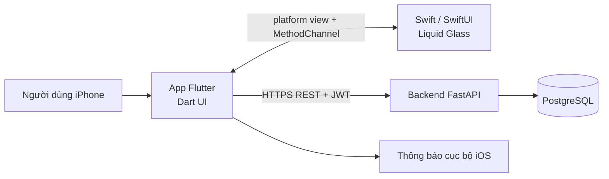

# Kiến trúc hệ thống

## Tổng quan


## Thành phần
| Thành phần | Công nghệ | Trách nhiệm |
|---|---|---|
| App mobile | Flutter (Dart), Riverpod, go_router, Dio, fl_chart | Giao diện, gọi API, biểu đồ, lưu token |
| Liquid Glass | Swift, SwiftUI `.glassEffect()` | Vẽ lớp kính lỏng native trên iOS 26+ |
| Backend | FastAPI, SQLAlchemy 2 async, Pydantic v2 | API REST, xác thực JWT, nghiệp vụ |
| CSDL | PostgreSQL 16, Alembic | Lưu dữ liệu, quản lý migration |
| Nhắc nhở | flutter_local_notifications (app), API reminders (backend) | Lưu lịch nhắc trên server, gửi thông báo cục bộ trên máy |
| Hạ tầng | Docker Compose, GitHub Actions | Chạy backend local, CI |

## Cấu trúc app Flutter
```
mobile/lib/
├── main.dart              # khởi tạo ProviderScope và MaterialApp.router
├── app/router.dart        # go_router
├── core/                  # theme.dart, api_client.dart
├── widgets/               # widget dùng chung
└── features/<tính-năng>/  # màn hình, provider, repository của từng tính năng
mobile/packages/liquid_glass/          # plugin Flutter cục bộ
├── lib/liquid_glass.dart              # widget LiquidGlass + supportsLiquidGlass()
└── ios/liquid_glass/Sources/liquid_glass/
    ├── LiquidGlassPlugin.swift        # đăng ký platform view và kênh
    ├── LiquidGlassPlatformView.swift  # UIHostingController bọc view SwiftUI
    ├── LiquidGlassView.swift          # .glassEffect() (iOS 26+)
    ├── LiquidGlassTabBar.swift        # thanh tab + nút thêm nhanh, GlassEffectContainer
    ├── LiquidGlassCardGroup.swift     # nhóm thẻ, morph bằng glassEffectID
    └── ColorARGB.swift                # Color(argb:) và HostedPlatformView dùng chung
```
Dùng plugin cục bộ thay vì thêm file vào `ios/Runner` để: Flutter tự đăng ký qua `GeneratedPluginRegistrant`, không phải sửa `project.pbxproj` (dễ xung đột khi merge), và test được riêng.

## Cầu nối Flutter và Swift (Liquid Glass)
1. Dart gọi `MethodChannel('liquid_glass').invokeMethod('supportsLiquidGlass')`.
2. Nếu `true` (iOS 26+), widget `LiquidGlass` đặt `UiKitView(viewType: 'healthtrack/liquid_glass')` làm nền, rồi vẽ nội dung Flutter lên trên.
3. Phía Swift, `LiquidGlassPlugin` đăng ký `LiquidGlassViewFactory`; factory tạo `UIHostingController` chứa `LiquidGlassView`, view này dùng `.glassEffect(.regular.tint().interactive())`.
4. Nếu `false` (iOS cũ, Android, test), widget dùng `BackdropFilter` + nền trong suốt làm bản dự phòng.

Tham số truyền qua `creationParams`: `cornerRadius`, `tint` (ARGB), `interactive`.

## Các widget Liquid Glass
| Widget Dart | viewType Swift | Mô tả |
|---|---|---|
| `LiquidGlass` | `healthtrack/liquid_glass` | Một lớp kính, nội dung Flutter vẽ phía trên |
| `LiquidGlassTabBar` | `healthtrack/liquid_glass_tab_bar` | Thanh tab dưới và nút thêm nhanh nổi (`.interactive()`), kính hòa vào nhau trong `GlassEffectContainer` |
| `LiquidGlassCardGroup` | `healthtrack/liquid_glass_card_group` | Nhiều thẻ trong một `GlassEffectContainer`; chạm một thẻ thì nó mở rộng, các thẻ khác co thành nút tròn, kính morph nhờ `glassEffectID` cùng namespace |

Tham số truyền qua `creationParams` (ví dụ `items`, `selected`, `tint`, `cards`). Hai widget mới còn có một `MethodChannel` riêng cho từng view tên `<viewType>/<viewId>`: Swift gửi `onSelect`, `onAdd`, `onExpand` lên Dart; Dart gửi `setSelected` xuống khi tab đổi do go_router.

Tab đang chọn do go_router quyết định (`StatefulNavigationShell.currentIndex`), thanh tab chỉ hiển thị và báo sự kiện chạm. Nội dung thẻ trong `LiquidGlassCardGroup` do Swift vẽ nên chiều cao phải truyền cố định.

## App kết nối backend
Chi tiết lớp token, HTTP, đăng nhập, điều hướng và dữ liệu ở [mobile/README.md](../mobile/README.md#kết-nối-backend). Điểm chính:
- Access token ngắn hạn (30 phút) và refresh token (7 ngày) lưu trong Keychain. Interceptor tự làm mới phiên khi gặp 401 và chỉ thử lại một lần, nên hết hạn token không làm người dùng bị đăng xuất đột ngột.
- Mở app: nếu có token thì gọi `/users/me` để khôi phục phiên; token hỏng thì về màn đăng nhập.
- Màn Tổng quan lấy dữ liệu từ `/water`, `/sleep`, `/weights`, `/goals`, `/medications`; vòng Activity Rings tính từ mục tiêu của người dùng (mặc định 2 lít nước, 8 giờ ngủ).
- Backend đã có API bước chân và bữa ăn; app chưa kết nối các API này nên chưa hiển thị hai chỉ số.

## Phân lớp backend
`router (api/v1)` → `service (services)` → `crud` → `model (SQLAlchemy)`. Schema Pydantic ở `schemas/`.

## Lớp CRUD generic và phân quyền theo user
`app/crud/base.py` có `CRUDBase[Model]` dùng chung cho mọi model, để không lặp code `get/list/create/update/delete`.

```python
metrics = CRUDBase(Metric)            # mặc định lọc theo cột user_id
shared  = CRUDBase(Unit, owner_field=None)  # model dùng chung, không thuộc user nào
await metrics.list(db, owner_id=current_user.id)
```
Quy tắc an toàn đã có test (`tests/test_crud_base.py`):
- Model có cột `user_id` thì **bắt buộc** truyền `owner_id`, thiếu sẽ báo `ValueError`.
- `create` luôn ghi đè `user_id` bằng `owner_id`, bỏ qua giá trị client gửi.
- `get/update/delete` bản ghi của người khác trả về `None`/`False`. Router đổi thành **404**, không dùng 403 để không lộ bản ghi có tồn tại.
- `update` không cho đổi `id` và `user_id`; `list` giới hạn tối đa 200 dòng.

Cách dùng trong tính năng mới: tạo `crud/<tên>.py` với `x = CRUDBase(Model)`, gọi từ `services/`, và luôn truyền `current_user.id` làm `owner_id`.

## Bảo mật
Mật khẩu băm bcrypt; JWT access token (30 phút) + refresh token (7 ngày), lưu trong Keychain qua `flutter_secure_storage`; mọi endpoint dữ liệu yêu cầu đăng nhập và chỉ trả dữ liệu của chính người dùng đó.

### Checklist bảo mật JWT và CORS (issue #36)
Mỗi dòng đều có test trong `backend/tests/test_security.py`.

| Hạng mục | Trạng thái |
|---|---|
| Secret lấy từ biến môi trường `JWT_SECRET`, không hard-code trong code | Đạt |
| Production từ chối khởi động nếu secret là giá trị mặc định hoặc ngắn hơn 32 ký tự | Đạt |
| Chỉ chấp nhận đúng thuật toán đã cấu hình (chặn đổi thuật toán, `alg: none`) | Đạt |
| Bắt buộc có `exp` và `sub`; token hết hạn bị từ chối | Đạt |
| Chỉ nhận token loại `access` (không nhận refresh token ở endpoint thường) | Đạt |
| Claim bổ sung (`extra`) không ghi đè được `sub`, `type`, `exp` | Đạt |
| Mật khẩu băm bcrypt có salt; hỗ trợ mật khẩu dài hơn 72 byte (SHA-256 trước bcrypt) | Đạt |
| Hash sai định dạng trong CSDL trả về `False`, không làm lỗi 500 | Đạt |
| CORS chỉ cho origin trong `CORS_ORIGINS`; production cấm `*` | Đạt |
| CORS chỉ mở các method và header cần dùng (`Authorization`, `Content-Type`) | Đạt |
| Thu hồi token (refresh token xoay vòng, danh sách chặn) | Chưa, làm cùng #34 (đăng nhập, refresh) |
| Giới hạn số lần đăng nhập sai (rate limit) | Chưa, đề xuất thêm ở Phase 5 |

Ghi chú: app iOS gốc không phải trình duyệt nên CORS không áp dụng cho app; CORS phục vụ Swagger UI và nếu sau này có bản web.
