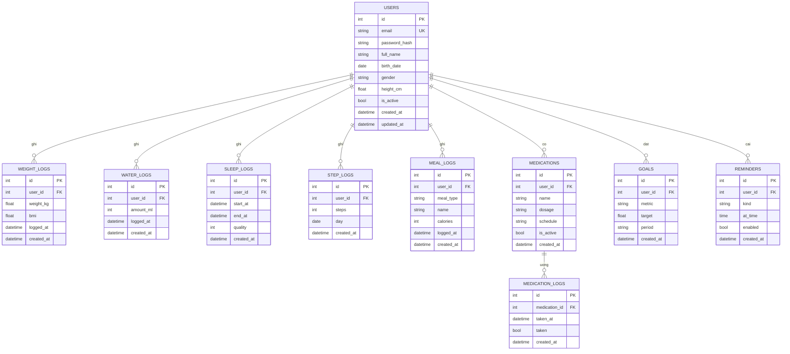

# Thiết kế cơ sở dữ liệu

ERD ban đầu cho PostgreSQL, hoàn thiện ở issue #24. Tech Lead review và chốt trong PR.

## Mô tả bảng

| Bảng | Mục đích | Ghi chú |
|---|---|---|
| `users` | Tài khoản và hồ sơ | `email` duy nhất; `password_hash` băm bcrypt, không lưu mật khẩu thô |
| `weight_logs` | Nhật ký cân nặng | `bmi` tính từ `weight_kg` và `users.height_cm` khi ghi |
| `water_logs` | Lượng nước uống mỗi lần | `amount_ml` > 0 |
| `sleep_logs` | Giấc ngủ | `end_at` > `start_at`; `quality` từ 1 đến 5 |
| `step_logs` | Số bước chân theo ngày | duy nhất theo (`user_id`, `day`) |
| `meal_logs` | Bữa ăn | `meal_type`: `breakfast`, `lunch`, `dinner`, `snack` |
| `medications` | Thuốc đang dùng | `schedule` mô tả lịch uống |
| `medication_logs` | Nhật ký uống thuốc | liên kết `medications`, xóa thuốc thì xóa nhật ký |
| `goals` | Mục tiêu theo chỉ số | `metric`: `weight`, `water`, `sleep`, `steps`, `calories`; `period`: `daily`, `weekly` |
| `reminders` | Nhắc nhở | `kind`: `water`, `medication`, `sleep`, `meal`... |

## Trạng thái triển khai (khớp migration thực tế)

| Bảng | Migration | Model |
|---|---|---|
| `users` | `0001` | `app/models/user.py` |
| `weight_logs` | `0002` | `app/models/weight_log.py` |
| `water_logs` | `0003` | `app/models/water_log.py` |
| `sleep_logs` | `0004` | `app/models/sleep_log.py` |
| `medications`, `medication_logs` | `0005` | `app/models/medication.py` |
| `step_logs`, `meal_logs`, `goals`, `reminders` | Chưa có | Sẽ bổ sung ở các issue tiếp theo |

Chi tiết đã chốt khi triển khai:

- `weight_logs.bmi` tính khi ghi từ `users.height_cm`; để `NULL` nếu hồ sơ chưa có chiều cao.
- `sleep_logs.quality` cho phép `NULL`; thời lượng không lưu mà tính từ `end_at - start_at`.
- `medication_logs` không có `user_id`; quyền sở hữu kiểm tra qua `medications.user_id`.
- Chỉ mục: `ix_weight_logs_user_id_logged_at`, `ix_water_logs_user_id_logged_at`, `ix_sleep_logs_user_id_start_at`, `ix_medications_user_id`, `ix_medication_logs_medication_id_taken_at`, `ix_users_email` (duy nhất).

## Ràng buộc và chỉ mục

- Mọi bảng dữ liệu của người dùng có `user_id` FK tới `users.id`, `ON DELETE CASCADE`. `medication_logs` có FK tới `medications.id`, cũng `ON DELETE CASCADE`.
- Mọi truy vấn lọc theo `user_id` để người dùng chỉ thấy dữ liệu của mình (xem `CRUDBase`).
- Chỉ mục: `users(email)` duy nhất; các bảng log có chỉ mục ghép (`user_id`, `logged_at`) hoặc (`user_id`, `day`) vì truy vấn thường lọc theo người dùng và khoảng thời gian.
- Thời gian lưu dạng UTC (`timestamptz`).

## Quy ước

Tên bảng số nhiều, snake_case, khóa chính `id` kiểu số nguyên tự tăng, có `created_at`. Mọi thay đổi cấu trúc phải đi kèm migration Alembic.
