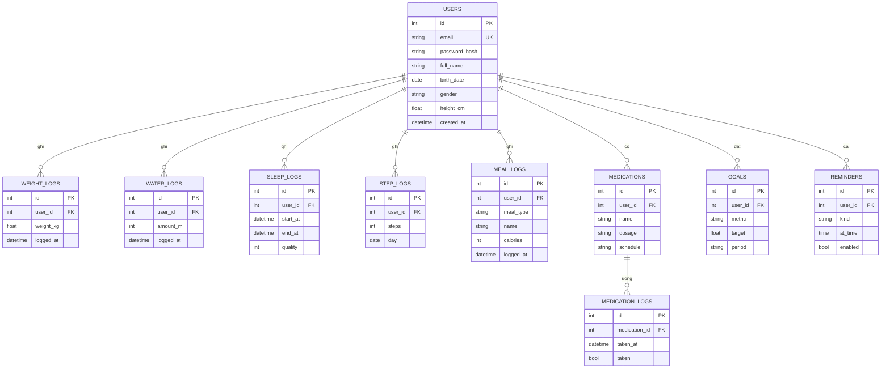

# Thiết kế cơ sở dữ liệu

Bản nháp ban đầu, Tân hoàn thiện và chốt ở issue Phase 1.

Quy ước: tên bảng số nhiều, snake_case, khóa chính `id`, có `created_at`. Mọi thay đổi cấu trúc phải đi kèm migration Alembic.
