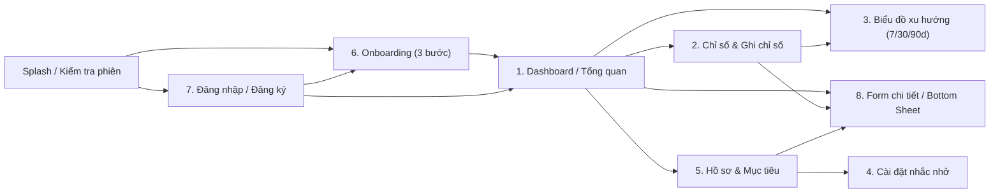
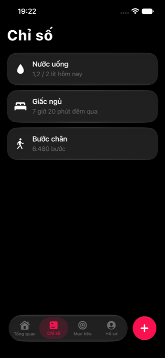

# Thiết kế giao diện

## Hướng thẩm mỹ: "Calm Health"
**Chủ đề:** nhật ký sức khỏe hằng ngày của người trẻ Việt Nam, mở app vài lần mỗi ngày để ghi nhanh và nhìn lại. Việc chính của giao diện là cho thấy hôm nay mình đã làm được bao nhiêu chỉ bằng một cái nhìn (trong 3 giây).

**Cảm giác:** chính xác, rõ ràng, ấm và có chiều sâu. Cao cấp nhưng không phô trương, tối giản nhưng không trống, thân thiện nhưng không trẻ con, chuyên nghiệp nhưng không lạnh như bệnh viện. Đẹp nhờ phân cấp, cân đối và dễ dùng chứ không nhờ hiệu ứng.

**Hướng tham khảo:** Apple Health ở chế độ sáng (nền xám nhạt, thẻ trắng) và Apple Fitness ở chế độ tối (nền đen, thẻ xám than, vòng hoạt động). Giao diện **theo cài đặt hệ thống** (`ThemeMode.system`), cả hai chế độ được thiết kế và kiểm tra như nhau.

**Nguyên tắc nhận diện:**
- **Màu thương hiệu là vàng.** Dùng có chủ đích: nút chính, tab đang chọn, nút `+`, điểm nhấn quan trọng. Không tô vàng cho mọi thẻ.
- Màu của từng chỉ số chỉ để phân biệt loại dữ liệu, không phải màu thương hiệu thứ hai.
- Thẻ nội dung là bề mặt đục, phân lớp bằng sắc nền; hầu như không viền, không bóng. Liquid Glass chỉ dành cho lớp nổi (thanh tab, nút `+`).
- Mỗi phần tử có một lý do chức năng. Không gradient và không kính trang trí.

**Đã bỏ khỏi bản "Mực biển":** nền xanh đêm, thương hiệu đỏ son, font Bricolage Grotesque, tiêu đề quá to, vầng sáng quanh vòng.

### Bảng màu
| Vai trò (token) | Dark | Light |
|---|---|---|
| `background` (nền) | `#000000` | `#F2F2F7` |
| `card` = `surface` (thẻ) | `#1C1C1E` | `#FFFFFF` |
| `cardHigh` = `surfaceElevated` (thẻ nổi) | `#2C2C2E` | `#E5E5EA` |
| `backgroundSecondary` (nền lõm: ô nhập) | `#111113` | `#E9E9EF` |
| `ink` (chữ chính) | `#F5F5F7` | `#1C1C1E` |
| `inkSoft` (chữ phụ) | `#9E9EA6` | `#58585E` |
| `textTertiary` (chú thích, không dùng cho thông tin cần đọc) | `#8E8E93` | `#6C6C70` |
| `separator` / `border` | `#38383A` / `#48484A` | `#D1D1D6` / `#C7C7CC` |
| `brand` (vàng, màu tô) | `#FFD60A` | `#FFC400` |
| `onBrand` (chữ/icon trên nền vàng) | `#1C1C1E` | `#1C1C1E` |
| `brandText` (chữ màu thương hiệu trên nền thường) | `#FFD60A` | `#7A5700` |
| `danger` / `success` / `warning` | `#FF6B6B` / `#30D158` / `#FF9F0A` | `#C62828` / `#1E7F3A` / `#9A5B00` |
| `disabled` | `#636366` | `#AEAEB2` |

Vàng tươi trên nền sáng không đủ tương phản làm chữ, nên tách ba token: `brand` để tô nền, `onBrand` cho chữ đặt trên nền vàng, `brandText` khi cần chữ hoặc icon màu thương hiệu trên nền thường.

| Chỉ số | Dark | Light |
|---|---|---|
| Bước chân (xanh lá) | `#30D158` | `#1B7F37` |
| Thuốc, vòng thứ nhất (san hô) | `#FF6F61` | `#C2412F` |
| Giấc ngủ (tím nhạt) | `#B39DFF` | `#5B45D6` |
| Nước uống (cyan) | `#32D4E8` | `#00758A` |
| Cân nặng (hổ phách ấm) | `#FFB340` | `#9A4F00` |
| Bữa ăn (hồng) | `#F26D9B` | `#B8325F` |
| Thuốc, thẻ (xanh trời) | `#5AA9FF` | `#1559B8` |

Mọi màu chữ và màu nhấn đạt tương phản >= 4.5:1 trên nền và thẻ ở cả hai chế độ, kể cả `onBrand` trên `brand` (test `theme_accessibility_test.dart` kiểm bằng công thức WCAG). Không dùng màu làm tín hiệu duy nhất: kèm nhãn chữ, icon hoặc phần trăm.

### Kiểu chữ
Dùng font hệ thống (SF Pro trên iOS) cho mọi chữ để Dynamic Type và VoiceOver hoạt động chuẩn. Số liệu dùng chữ số đều bề rộng (`tabularFigures`). Kiểu chữ lấy qua `context.text` (đã có màu đúng chế độ):

| Vai trò | Kiểu | Cỡ, độ đậm |
|---|---|---|
| Tiêu đề lớn của màn | `largeTitle` | 34, 700 |
| Đầu mục | `sectionTitle` | 20, 600 |
| Tiêu đề thẻ | `cardTitle` | 15, 600 |
| Số chính | `metric` | 32, 600, chữ số đều |
| Nội dung | `body` | 17 |
| Thông tin phụ | `secondary` | 15 |
| Chú thích | `caption` | 13 |
| Nhãn nút | `button` | 17, 600 |

Tạo phân cấp bằng cỡ, độ đậm, khoảng cách và độ tương phản, không in đậm mọi tiêu đề. Câu chữ theo câu, không dùng chữ HOA tràn lan; nút ghi đúng việc sẽ xảy ra ("Thêm nước", "Lưu").

### Khoảng cách, bo góc, đổ bóng
- Khoảng cách `AppSpacing`: 4 / 8 / 12 / 16 / 20 / 24 / 32 (`xxs`, `xs`, `sm`, `md`, `ml`, `lg`, `xl`).
- Bo góc `AppRadius`: thẻ 16, ô điều khiển 12, sheet 20, viên thuốc (pill). Phần tử lồng trong thẻ bo đồng tâm (bán kính nhỏ hơn đúng bằng lề trong).
- Đệm cuối danh sách để không bị thanh tab che: `AppLayout.tabBarInset(context)`.
- Gần như không dùng bóng đổ và viền; phân lớp bằng sắc nền.

### Chuyển động
Chỉ dùng để báo điều gì vừa thay đổi: vòng đầy lên khi mở màn Tổng quan, số đếm lên khi giá trị đổi, rung nhẹ (haptic) khi ghi dữ liệu xong. Lò xo nhẹ, không nảy lâu, không có hiệu ứng trang trí chạy liên tục và không trượt/mờ dần cho mỗi thẻ. Mọi thời lượng lấy từ `AppMotion`, và bằng 0 khi người dùng bật Giảm chuyển động.

## Nguyên tắc
- Giao diện chính là **iPhone**, dùng **Liquid Glass của iOS 26** cho lớp nổi.
- **Quy chuẩn Liquid Glass:** chỉ dùng cho lớp điều hướng nổi và nhóm thẻ tương tác nổi bật (thanh tab dưới, nút thêm nhanh nổi `+`, nhóm thẻ `LiquidGlassCardGroup`, modal sheet nổi), **không** phủ kính cho toàn bộ danh sách cuộn dài để giữ hiệu năng (tránh tạo nhiều platform view `UiKitView`) và giữ phân cấp thị giác rõ ràng. Thẻ nội dung thông thường dùng bề mặt phẳng `AppColors.card`.
- View kính native dùng `dark: true` ở Dark Mode để đồng bộ nền.
- Toàn bộ màu sắc, bo góc, chuyển động và kiểu chữ lấy từ `mobile/lib/core/theme.dart` (không hard-code trong màn hình).
- Hỗ trợ Dynamic Type (co giãn font chữ), VoiceOver (`Semantics` đầy đủ cho nút, thẻ, tiêu đề, thông báo lỗi) và hiển thị chuẩn từ **iPhone SE (`375x667`)** đến **iPhone Pro Max (`430x932`)**.

## Thành phần dùng chung (`mobile/lib/widgets/`)
- `ActivityRings`: các vòng đồng tâm có hoạt ảnh chạy lên tiến độ; vòng đầu ở ngoài cùng.
- `MetricCard`: tên có màu nhấn, số lớn, đường xu hướng sparkline nhỏ.
- `SectionHeader`: tiêu đề mục chữ đậm kèm mũi tên điều hướng.
- `AppTextField`, `PrimaryButton`, `ErrorText`: bộ thành phần form đồng bộ bo góc 14 và validation.

## Thanh tab Liquid Glass (`LiquidGlassTabBar`)

**Kiến trúc.** Dart (`mobile/lib/app/app_shell.dart`) giữ trạng thái điều hướng bằng `StatefulNavigationShell` của go_router. Thanh tab là một Platform View (`UiKitView`, `healthtrack/liquid_glass_tab_bar`); Dart gửi `setSelected`, Swift gửi `onSelect` và `onAdd` qua MethodChannel, nên chỉ có một nguồn trạng thái là go_router.

**iOS 26+: `UITabBarController` thật của hệ thống** (`NativeTabBar.swift`). Thấu kính chọn tab, hiệu ứng nhấn giữ phình ra và kéo qua các tab, khúc xạ ở rìa kính, haptic và trợ năng (VoiceOver, Giảm trong suốt, Giảm chuyển động) đều là hành vi có sẵn của hệ thống. Bài học: đã thử tự vẽ bằng SwiftUI (`GlassEffectContainer`, `glassEffectID`, cử chỉ kéo tự viết) nhưng không tái tạo được hiệu ứng thấu kính của Apple; các package Flutter làm thanh tab iOS 26 (ví dụ `native_glass_navbar`, `real_liquid_glass`) đều nhúng `UITabBar` thật. Nút thêm nhanh `+` là `UIButton` với `UIButton.Configuration.prominentGlass()`, đứng riêng bên phải để không ảnh hưởng số tab.

**Kích thước và vị trí.** Chiều cao viên kính do hệ thống quyết định (khoảng 60 đến 62pt, theo báo cáo của developer trên diễn đàn Apple, không có số chính thức). Platform View phải kéo dài xuống sát đáy màn hình (cao `LiquidGlassTabBar.height` cộng lề an toàn dưới, không bọc `SafeArea`) để `UITabBar` tự đặt lề dưới như app Apple: viên kính nằm trong vùng home indicator, cách đáy khoảng 22 đến 24pt. Đặt Platform View phía trên vùng an toàn thì thanh bị nổi cao. Nút `+` căn theo tâm viên kính thật (tìm theo hình học, không dùng tên lớp riêng tư).\n\n**Chế độ sáng/tối.** `overrideUserInterfaceStyle` theo nền của app, không theo cài đặt hệ thống. Màu thương hiệu đặt qua `tabBar.tintColor`.

**iOS dưới 26.** Dùng thanh SwiftUI cũ (`LiquidGlassTabBar.swift`, `.ultraThinMaterial`).

**Dự phòng (không phải Liquid Glass thật).** iOS dưới 26 dùng `.ultraThinMaterial` trong SwiftUI; Android và test dùng `BackdropFilter` + `ImageFilter.blur` của Flutter. Đây chỉ là mờ nền, không có khúc xạ quang học.

**Hiệu năng.** Chỉ một Platform View cho thanh tab, không có vòng animation chạy nền; chuyển động do hệ thống xử lý.

**Giới hạn đã biết.** Khúc xạ ở rìa kính do hệ thống quyết định và phụ thuộc vào Flutter texture phía sau; không thể chỉnh độ khúc xạ. Màu thương hiệu của thanh tab là vàng (`brand`).

## Widget `LiquidGlass`
```dart
LiquidGlass(
  cornerRadius: 24,
  tint: AppColors.brand.withValues(alpha: 0.15),
  interactive: true,
  child: ...,
)
```
Trên iOS 26+ dùng lớp kính SwiftUI `.glassEffect()` qua platform view; nơi khác dùng `BackdropFilter` dự phòng.

## Danh sách màn hình & Luồng điều hướng



---

## Wireframe 8 màn hình chính (iPhone 393×852 / iOS 26)

> **Ký hiệu trong wireframe:**
> - `[LG]` = Thành phần áp dụng hiệu ứng **Liquid Glass** (platform view / `.glassEffect()`)
> - `[Card]` = Thẻ nội dung phẳng `AppColors.card` (`#12293D`, `cornerRadius: 20`)
> - `[Btn]` = Nút hành động chính `AppColors.brand` (`#D93A2E`)

### 1. Dashboard / Tổng quan (`HomeScreen`)
Hiển thị nhanh tình trạng sức khỏe trong ngày ngay khi mở app, hỗ trợ Pull-to-Refresh.

```text
+------------------------------------------+
|  9:41         [ Dynamic Island ]     ||| |
|------------------------------------------|
|  THỨ TƯ, 11 THÁNG 11                     |
|  Tổng quan                       ( N )   |  <- Avatar chữ cái đầu
|                                          |
|  Hôm nay                           >     |
|  +------------------------------------+  |
|  | [Card / LG]                        |  |
|  |    ((( )))   Nước uống  1,2 /2 LÍT |  |  <- ActivityRings 3 vòng đồng tâm
|  |    (( O ))   Giấc ngủ   7,5 /8 GIỜ |  |
|  |              Thuốc      1   /2 LIỀU|  |
|  +------------------------------------+  |
|                                          |
|  Chỉ số cơ thể                     >     |
|  +----------------+  +----------------+  |
|  | [Card]         |  | [Card]         |  |
|  | o Cân nặng     |  | o BMI          |  |
|  | 66,6 kg        |  | 23,0           |  |
|  | ~~sparkline~~  |  | Bình thường    |  |
|  +----------------+  +----------------+  |
|  +----------------+  +----------------+  |
|  | [Card]         |  | [Card]         |  |
|  | o Giấc ngủ     |  | o Nước uống    |  |
|  | 7,5 giờ        |  | 1,2 lít        |  |
|  +----------------+  +----------------+  |
|                                          |
|  7 ngày qua (Nước uống)            >     |  <- Chạm mở màn Biểu đồ xu hướng
|  +------------------------------------+  |
|  | [Card]  |   |   |  ||  |   |   |   |  |
|  +------------------------------------+  |
|                                          |
|  +-------------------------------+  (+)  |  <- [LG] LiquidGlassTabBar
|  | [LG] Tổng quan|Chỉ số|Mục tiêu|Hồ sơ |     & [LG] Nút nổi interactive
|  +-------------------------------+       |
+------------------------------------------+
```

- **Điểm nhấn Liquid Glass:** Thanh tab nổi phía dưới (`LiquidGlassTabBar`) và nút thêm nhanh `+` (`interactive: true`).

---

### 2. Chỉ số & Ghi chỉ số (`MetricsScreen` + `AddScreen`)
Màn **Chỉ số** sử dụng `LiquidGlassCardGroup` cho hiệu ứng morph khi chạm mở rộng từng thẻ; chạm nút `+` để mở modal **Ghi chỉ số**.

```text
+------------------------------------------+
|  Chỉ số                             [~]  |  <- Nút mở Biểu đồ xu hướng
|                                          |
|  +------------------------------------+  |
|  | [LG] GlassCard: Nước uống          |  |  <- LiquidGlassCardGroup (morph)
|  |      1,2 lít hôm nay               |  |     Chạm để bung chi tiết 7 ngày
|  +------------------------------------+  |
|  +------------------------------------+  |
|  | [LG] GlassCard: Giấc ngủ           |  |
|  |      7 giờ 30 phút                 |  |
|  |      Trung bình 7h20 / đêm qua 7d  |  |
|  +------------------------------------+  |
|  +------------------------------------+  |
|  | [LG] GlassCard: Cân nặng           |  |
|  |      66,6 kg · BMI 23,0            |  |
|  +------------------------------------+  |
|                                          |
|  +-------------------------------+  (+)  |  <- [LG] TabBar + Floating '+'
+------------------------------------------+
```

- **Điểm nhấn Liquid Glass:** Toàn bộ nhóm thẻ [`LiquidGlassCardGroup`](../mobile/packages/liquid_glass/lib/src/card_group.dart) dùng `GlassEffectContainer` hợp nhất trên iOS 26+.

---

### 3. Biểu đồ xu hướng (`TrendChartsScreen`)
Xem diễn biến chỉ số theo 7 / 30 / 90 ngày bằng `fl_chart`, hỗ trợ chạm điểm/cột xem Tooltip.

```text
+------------------------------------------+
|  <  Xu hướng                             |
|------------------------------------------|
|  [Nước] [Bước chân] [Ngủ] [Cân nặng]     |  <- ChoiceChip chọn chỉ số
|                                          |
|  +------------------------------------+  |
|  |  [ 7 ngày ] |  30 ngày  |  90 ngày |  |  <- Segmented Control
|  +------------------------------------+  |
|                                          |
|  +------------------------------------+  |
|  | [Card] Nước uống            7 ngày |  |
|  | 11/11: 1,5 lít        <-- Tooltip  |  |
|  |                                    |  |
|  |   2.0 |       [1,5]                |  |
|  |   1.0 |   |    |    |    |    |    |  |  <- fl_chart BarChart / LineChart
|  |   0.0 +----------------------------|  |
|  |       05/11   07/11   09/11  11/11 |  |
|  +------------------------------------+  |
|                                          |
|  Tóm tắt                                 |
|  +----------+ +----------+ +----------+  |
|  | [Card]   | | [Card]   | | [Card]   |  |
|  | Trungbình| | Cao nhất | | Thấp nhất|  |
|  | 1,4 lít  | | 2,0 lít  | | 0,8 lít  |  |
|  +----------+ +----------+ +----------+  |
+------------------------------------------+
```

---

### 4. Cài đặt nhắc nhở (`RemindersScreen`)
Quản lý lịch nhắc hằng ngày (uống nước, uống thuốc, đi ngủ, bữa ăn), bật/tắt nhanh từng nhắc nhở.

```text
+------------------------------------------+
|  <  Nhắc nhở                        (+)  |
|------------------------------------------|
|  +------------------------------------+  |
|  | [Card]                             |  |
|  | (o)  08:30               [ ===O ]  |  |  <- Switch.adaptive bật/tắt
|  |      Uống nước · Đang bật          |  |     (Chạm thẻ mở BottomSheet sửa)
|  +------------------------------------+  |
|  +------------------------------------+  |
|  | [Card]                             |  |
|  | (+)  12:00               [ ===O ]  |  |
|  |      Uống thuốc · Đang bật         |  |
|  +------------------------------------+  |
|  +------------------------------------+  |
|  | [Card]                             |  |
|  | (C)  22:30               [ O=== ]  |  |
|  |      Đi ngủ · Đang tắt             |  |
|  +------------------------------------+  |
|                                          |
|  [ EmptyState nếu danh sách rỗng ]       |
|  [ + Thêm nhắc nhở ]                     |
+------------------------------------------+
```

---

### 5. Hồ sơ cá nhân & Mục tiêu (`ProfileScreen` & `GoalsScreen`)
Quản lý thông tin tài khoản, chiều cao (để tính BMI), mục tiêu ngày, mở màn Nhắc nhở và Đăng xuất.

```text
+------------------------------------------+
|  Hồ sơ                              [~]  |  <- Nút mở lại Onboarding
|------------------------------------------|
|   ( N )   Người dùng Demo                |
|           demo@healthtrack.app           |
|                                          |
|  +------------------------------------+  |
|  | [Card] Thông tin cá nhân           |  |
|  |  Họ và tên       Người dùng Demo > |  |
|  |  Giới tính              Chưa đặt > |  |
|  |  Ngày sinh              Chưa đặt > |  |
|  |  Chiều cao                170 cm > |  |
|  +------------------------------------+  |
|  +------------------------------------+  |
|  | [Card] Nhắc nhở          Cài đặt > |  |
|  +------------------------------------+  |
|                                          |
|  +------------------------------------+  |
|  |          [ Đăng xuất ]             |  |  <- OutlinedButton (danger)
|  +------------------------------------+  |
|                                          |
|  +-------------------------------+  (+)  |  <- [LG] TabBar
+------------------------------------------+
```

---

### 6. Onboarding 3 bước (`OnboardingScreen`)
Thu thập thông tin cá nhân và chỉ số ban đầu ngay sau khi người dùng mới đăng ký tài khoản.

```text
+------------------------------------------+
|  <       [===] [ ] [ ]          Bỏ qua   |  <- Thanh tiến độ 3 bước
|------------------------------------------|
|  Bước 1: Giới thiệu                      |
|      <3  Chào mừng đến HealthTrack       |
|      - Theo dõi nước, ngủ, bước chân     |
|      - Tự động tính chỉ số BMI           |
|                                          |
|  Bước 2: Thông tin cá nhân               |
|      [ Họ và tên              ]          |
|      Giới tính: (Nam) (Nữ) (Khác)        |
|      Ngày sinh: [ 01/01/2000 ]           |
|                                          |
|  Bước 3: Chỉ số ban đầu                  |
|      [ Chiều cao (cm)         ]          |
|      [ Cân nặng (kg)          ]          |
|      [Card] BMI ban đầu: 23,0 · Bình thường
|                                          |
|  +------------------------------------+  |
|  | [Btn]    Tiếp tục / Hoàn tất       |  |
|  +------------------------------------+  |
+------------------------------------------+
```

---

### 7. Đăng nhập / Đăng ký (`LoginScreen` & `RegisterScreen`)
Xác thực tài khoản gọn nhẹ, hỗ trợ Autofill iOS và hiển thị lỗi trực tiếp dưới form.

```text
+------------------------------------------+
|                                          |
|                  <3                      |  <- Icon thương hiệu (#FA114F)
|  Đăng nhập                               |
|  Theo dõi sức khỏe mỗi ngày.             |
|                                          |
|  +------------------------------------+  |
|  | [Card / AppTextField] Email        |  |
|  +------------------------------------+  |
|  +------------------------------------+  |
|  | [Card / AppTextField] Mật khẩu     |  |
|  +------------------------------------+  |
|                                          |
|     (Lỗi validation / 401 nếu có)        |
|                                          |
|  +------------------------------------+  |
|  | [Btn / PrimaryButton] Đăng nhập    |  |
|  +------------------------------------+  |
|       Chưa có tài khoản? Đăng ký         |
+------------------------------------------+
```

---

### 8. Form chi tiết / Bottom Sheet (`AddScreen` & Modal Sheets)
Ghi nhanh 6 nhóm chỉ số (Nước, Cân nặng + BMI, Ngủ, Thuốc, Bước chân, Bữa ăn) và Bottom Sheet chọn giờ iOS (`CupertinoDatePicker`) cho nhắc nhở.

```text
+------------------------------------------+
|  (X)  Thêm nhanh                         |  <- Đóng modal
|------------------------------------------|
|  (Nước) (Cân nặng) (Ngủ) (Thuốc) ...     |  <- ChoiceChip chuyển form
|                                          |
|  [ Tab Nước ]                            |
|  (150ml) (250ml) (330ml) (500ml)         |
|  +------------------------------------+  |
|  | Hoặc nhập số khác (ml)             |  |
|  +------------------------------------+  |
|                                          |
|  [ Tab Cân nặng / BMI ]                  |
|  +------------------------------------+  |
|  | [Card] BMI dự kiến: 23,5 · Bình thường
|  +------------------------------------+  |
|                                          |
|  ==== Sheet chọn giờ (Nhắc nhở) ====     |
|  +------------------------------------+  |
|  | [LG / Sheet]        ---            |  |  <- BottomSheet bo góc 24
|  |  Chọn giờ nhắc nhở            (X)  |  |
|  |       08   :   29                  |  |
|  |     > 08   :   30 <  CupertinoWheel|  |
|  |       08   :   31                  |  |
|  |  Bật nhắc nhở            [ ===O ]  |  |
|  |  [Btn]      Lưu thay đổi           |  |
|  +------------------------------------+  |
+------------------------------------------+
```

---

## Tổng hợp vị trí áp dụng Liquid Glass

| Vị trí | Widget | Áp dụng Liquid Glass? | Ghi chú |
|---|---|---|---|
| Thanh điều hướng dưới | `LiquidGlassTabBar` | **Có** (`GlassEffectContainer`) | Nổi cố định trên 4 tab chính |
| Nút thêm nhanh nổi `+` | `LiquidGlassTabBar` (`onAdd`) | **Có** (`interactive: true`) | Phản hồi chạm đàn hồi iOS 26 |
| Nhóm thẻ màn Chỉ số | `LiquidGlassCardGroup` | **Có** (`morph` animation) | Mở rộng chi tiết từng thẻ chỉ số |
| Modal Sheet nổi (tùy chọn) | `LiquidGlass` / BottomSheet | **Có** | Dùng `tint` tối giữ contrast `>= 4.5:1` |
| Thẻ trong danh sách cuộn dài | `AppCard`, `MetricCard`, `ListTile` | **Không** (dùng `AppColors.card`) | Tối ưu GPU/FPS theo Apple HIG |

## Ảnh chụp thực tế
iPhone 13, iOS 27.2 Simulator.

Tổng quan (Activity Rings, thẻ chỉ số, thanh tab Liquid Glass):


Chỉ số (nhóm thẻ Liquid Glass, chạm để mở rộng và morph):


