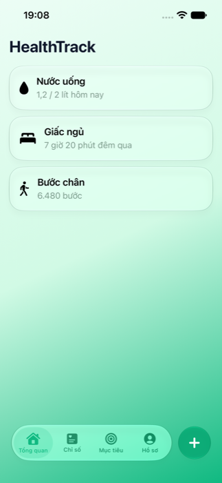

# Thiết kế giao diện

## Nguyên tắc
- Giao diện chính là **iPhone**, theo ngôn ngữ thiết kế **Liquid Glass của iOS 26**: lớp kính lỏng cho thanh tab, thẻ, nút nổi; nội dung nằm trên nền gradient xanh lá nhẹ.
- Màu, chữ, bo góc lấy từ `mobile/lib/core/theme.dart`. Dùng skill `baoyu-design` khi thiết kế.
- Hỗ trợ sáng/tối, Dynamic Type, VoiceOver; kiểm tra trên iPhone SE và iPhone Pro Max.
- Chỉ dùng Liquid Glass cho lớp điều hướng và thẻ nổi bật, không phủ kính toàn bộ nội dung (theo hướng dẫn của Apple).

## Widget `LiquidGlass`
```dart
LiquidGlass(
  cornerRadius: 24,
  tint: Colors.green.withValues(alpha: 0.15),
  interactive: true,
  child: ...,
)
```
Trên iOS 26+ dùng lớp kính Swift native; nơi khác dùng `BackdropFilter`. Tránh dùng trong danh sách cuộn dài (mỗi thẻ là một platform view).

## Danh sách màn hình
| Tab | Màn hình |
|---|---|
| Trang chủ | Dashboard tóm tắt hôm nay, biểu đồ xu hướng |
| Ghi chỉ số | Cân nặng, nước, ngủ, bước chân, bữa ăn, thuốc |
| Nhắc nhở | Danh sách và form nhắc nhở |
| Hồ sơ | Thông tin cá nhân, mục tiêu, cài đặt |
| Ngoài tab | Onboarding, Đăng ký, Đăng nhập |

Wireframe chi tiết: cần bổ sung (issue Phase 0 của Thuận).

## Ảnh chụp thực tế
Thanh tab Liquid Glass, nút thêm nhanh và nhóm thẻ trên iPhone 13 (iOS 27.2 Simulator):


