# Thiết kế giao diện

## Hướng thẩm mỹ: "Calm Health"
**Chủ đề:** nhật ký sức khỏe hằng ngày của người trẻ Việt Nam, mở app vài lần mỗi ngày để ghi nhanh và nhìn lại. Việc chính của giao diện là cho thấy hôm nay mình đã làm được bao nhiêu chỉ bằng một cái nhìn (trong 3 giây).

**Cảm giác:** chính xác, rõ ràng, ấm và có chiều sâu. Cao cấp nhưng không phô trương, tối giản nhưng không trống, thân thiện nhưng không trẻ con, chuyên nghiệp nhưng không lạnh như bệnh viện. Đẹp nhờ phân cấp, cân đối và dễ dùng chứ không nhờ hiệu ứng.

**Hướng tham khảo:** Apple Health ở chế độ sáng (nền xám nhạt, thẻ trắng) và Apple Fitness ở chế độ tối (nền đen, thẻ xám than, vòng hoạt động). Giao diện **theo cài đặt hệ thống** (`ThemeMode.system`), cả hai chế độ được thiết kế và kiểm tra như nhau.

**Nguyên tắc nhận diện:**
- **Màu thương hiệu là vàng.** Dùng có chủ đích: nút chính, tab đang chọn, nút `+`, điểm nhấn quan trọng. Không tô vàng cho mọi thẻ.
- Màu của từng chỉ số chỉ để phân biệt loại dữ liệu, không phải màu thương hiệu thứ hai.
- Thẻ nội dung là bề mặt đục, phân lớp bằng sắc nền; hầu như không viền, không bóng. Liquid Glass chỉ dành cho lớp nổi (thanh tab, nút `+`).
- Mỗi phần tử có một lý do chức năng. Không gradient và không kính trang trí.

**Đã bỏ khỏi bản "Mực biển":** nền xanh đêm, thương hiệu đỏ son, font Bricolage Grotesque, tiêu đề quá to, vầng sáng quanh vòng.

### Bảng màu
| Vai trò (token) | Dark | Light |
|---|---|---|
| `background` (nền) | `#000000` | `#F2F2F7` |
| `card` = `surface` (thẻ) | `#1C1C1E` | `#FFFFFF` |
| `cardHigh` = `surfaceElevated` (thẻ nổi) | `#2C2C2E` | `#E5E5EA` |
| `backgroundSecondary` (nền lõm: ô nhập) | `#111113` | `#E9E9EF` |
| `ink` (chữ chính) | `#F5F5F7` | `#1C1C1E` |
| `inkSoft` (chữ phụ) | `#9E9EA6` | `#58585E` |
| `textTertiary` (chú thích, không dùng cho thông tin cần đọc) | `#8E8E93` | `#6C6C70` |
| `separator` / `border` | `#38383A` / `#48484A` | `#D1D1D6` / `#C7C7CC` |
| `brand` (vàng, màu tô) | `#FFD60A` | `#FFC400` |
| `onBrand` (chữ/icon trên nền vàng) | `#1C1C1E` | `#1C1C1E` |
| `brandText` (chữ màu thương hiệu trên nền thường) | `#FFD60A` | `#7A5700` |
| `danger` / `success` / `warning` | `#FF6B6B` / `#30D158` / `#FF9F0A` | `#C62828` / `#1E7F3A` / `#9A5B00` |
| `disabled` | `#636366` | `#AEAEB2` |

Vàng tươi trên nền sáng không đủ tương phản làm chữ, nên tách ba token: `brand` để tô nền, `onBrand` cho chữ đặt trên nền vàng, `brandText` khi cần chữ hoặc icon màu thương hiệu trên nền thường.

| Chỉ số | Dark | Light |
|---|---|---|
| Bước chân (xanh lá) | `#30D158` | `#1B7F37` |
| Thuốc, vòng thứ nhất (san hô) | `#FF6F61` | `#C2412F` |
| Giấc ngủ (tím nhạt) | `#B39DFF` | `#5B45D6` |
| Nước uống (cyan) | `#32D4E8` | `#00758A` |
| Cân nặng (hổ phách ấm) | `#FFB340` | `#9A4F00` |
| Bữa ăn (hồng) | `#F26D9B` | `#B8325F` |
| Thuốc, thẻ (xanh trời) | `#5AA9FF` | `#1559B8` |

Mọi màu chữ và màu nhấn đạt tương phản >= 4.5:1 trên nền và thẻ ở cả hai chế độ, kể cả `onBrand` trên `brand` (test `theme_accessibility_test.dart` kiểm bằng công thức WCAG). Không dùng màu làm tín hiệu duy nhất: kèm nhãn chữ, icon hoặc phần trăm.

### Kiểu chữ
Dùng font hệ thống (SF Pro trên iOS) cho mọi chữ để Dynamic Type và VoiceOver hoạt động chuẩn. Số liệu dùng chữ số đều bề rộng (`tabularFigures`). Kiểu chữ lấy qua `context.text` (đã có màu đúng chế độ):

| Vai trò | Kiểu | Cỡ, độ đậm |
|---|---|---|
| Tiêu đề lớn của màn | `largeTitle` | 34, 700 |
| Đầu mục | `sectionTitle` | 20, 600 |
| Tiêu đề thẻ | `cardTitle` | 15, 600 |
| Số chính | `metric` | 32, 600, chữ số đều |
| Nội dung | `body` | 17 |
| Thông tin phụ | `secondary` | 15 |
| Chú thích | `caption` | 13 |
| Nhãn nút | `button` | 17, 600 |

Tạo phân cấp bằng cỡ, độ đậm, khoảng cách và độ tương phản, không in đậm mọi tiêu đề. Câu chữ theo câu, không dùng chữ HOA tràn lan; nút ghi đúng việc sẽ xảy ra ("Thêm nước", "Lưu").

### Khoảng cách, bo góc, đổ bóng
- Khoảng cách `AppSpacing`: 4 / 8 / 12 / 16 / 20 / 24 / 32 (`xxs`, `xs`, `sm`, `md`, `ml`, `lg`, `xl`).
- Bo góc `AppRadius`: thẻ 16, ô điều khiển 12, sheet 20, viên thuốc (pill). Phần tử lồng trong thẻ bo đồng tâm (bán kính nhỏ hơn đúng bằng lề trong).
- Đệm cuối danh sách để không bị thanh tab che: `AppLayout.tabBarInset(context)`.
- Gần như không dùng bóng đổ và viền; phân lớp bằng sắc nền.

### Chuyển động
Chỉ dùng để báo điều gì vừa thay đổi: vòng đầy lên khi mở màn Tổng quan, số đếm lên khi giá trị đổi, rung nhẹ (haptic) khi ghi dữ liệu xong. Lò xo nhẹ, không nảy lâu, không có hiệu ứng trang trí chạy liên tục và không trượt/mờ dần cho mỗi thẻ. Mọi thời lượng lấy từ `AppMotion`, và bằng 0 khi người dùng bật Giảm chuyển động.

## Nguyên tắc
- Giao diện chính là **iPhone**, dùng **Liquid Glass của iOS 26** cho lớp nổi.
- **Quy chuẩn Liquid Glass:** dùng cho lớp điều hướng nổi (thanh tab dưới và nút thêm nhanh nổi `+`) và các **nút**: nút icon tròn ở đầu trang (Coach, cài đặt, quay lại, đóng), nút hành động chính (Đăng nhập, Lưu, Thêm...) và Hủy/Lưu trong form sheet. Hàng trong danh sách giữ nguyên dạng hàng. **Không** phủ kính lên thẻ nội dung: thẻ là bề mặt đục `AppCard` (màu `card` của bảng màu) để giữ hiệu năng (không tạo thêm platform view `UiKitView`), giữ phân cấp rõ ràng và chữ đủ tương phản.
- View kính native dùng `dark: true` ở Dark Mode để đồng bộ nền.
- Toàn bộ màu sắc, bo góc, chuyển động và kiểu chữ lấy từ `mobile/lib/core/theme.dart` (không hard-code trong màn hình).
- Hỗ trợ Dynamic Type (co giãn font chữ), VoiceOver (`Semantics` đầy đủ cho nút, thẻ, tiêu đề, thông báo lỗi) và hiển thị chuẩn từ **iPhone SE (`375x667`)** đến **iPhone Pro Max (`430x932`)**.

## Thành phần dùng chung (`mobile/lib/widgets/`)
Thẻ nội dung là bề mặt đục. Mọi màn dùng các thành phần dưới đây thay vì tự vẽ lại kiểu.

| Thành phần | Dùng để |
|---|---|
| `AppCard` | Thẻ nền đục, bo 16, không bóng; có `onTap` thì mờ nhẹ khi nhấn |
| `MetricCard` | Thẻ số liệu kiểu Apple Health: icon và tên theo màu danh mục, số lớn kèm đơn vị, đường xu hướng mảnh; `onTap` mở biểu đồ xu hướng |
| `ActivityRings` | Các vòng đồng tâm mảnh, chạy lên tiến độ khi mở (tôn trọng Giảm chuyển động), không có vầng sáng |
| `SectionHeader` | Đầu mục 20 semibold, có `actionLabel` ("Xem tất cả") khi bấm được |
| `SettingsGroup` + `SettingsRow` | Nhóm hàng kiểu Cài đặt iOS: hàng cao tối thiểu 44, icon trong ô màu, giá trị bên phải, mũi tên; `SettingsRow.toggle` dùng `Switch.adaptive`; hàng `destructive` chữ đỏ |
| `showFormSheet` + `FormSheetController` | Form dạng sheet: Hủy / tiêu đề / Lưu, Lưu tắt khi chưa hợp lệ, tránh bàn phím, hỏi "Bỏ thay đổi?" khi đã sửa. Mở ở navigator gốc để phủ cả thanh tab. Kéo xuống để đóng bị tắt vì Flutter không cho chặn thao tác này |
| `adaptiveDialogAction` | Nút của `AlertDialog.adaptive`: `CupertinoDialogAction` trên iOS, `TextButton` nơi khác |
| `AppTextField`, `PrimaryButton`, `SecondaryButton`, `ErrorText` | Bộ form: ô nhập bo 12 có hậu tố đơn vị, `helperText`, `errorText`; nút chính (`PrimaryButton` = `GlassButton.prominent`): kính nhuộm vàng chữ `onBrand`, cao 50 |
| `RoundIconButton` | Nút icon tròn Liquid Glass ở đầu trang: vòng kính 44 pt (đúng vùng chạm tối thiểu 44×44 pt của Apple HIG và chiều cao nút trên thanh điều hướng iOS), icon 0,4 × cỡ nút (khoảng 17,6 pt). Trước đây là 34 pt nên nhìn nhỏ (cần tên SF Symbol `symbol` cho iOS và icon `AppIcons` cho bản dự phòng) |
| `AppActivityIndicator`, `AppRefreshList` | Kim quay kiểu iOS (`CupertinoActivityIndicator`) và danh sách kéo để làm mới kiểu Cupertino; nơi khác dùng vòng Material và `RefreshIndicator` |
| `SkeletonGroup`, `SkeletonBlock` và `skeletons.dart` | Khung đặt chỗ kiểu "redacted" của SwiftUI theo hình nội dung thật (thẻ chỉ số, thẻ Hôm nay, nhóm cài đặt, Hồ sơ, Mục tiêu, Huy hiệu); cả nhóm thở nhẹ, đứng yên khi Giảm chuyển động |
| `EmptyState`, `ErrorState`, `LoadingState`, `AppSkeleton` | Trạng thái rỗng (icon tròn và nút kính vàng), lỗi (Thử lại), đang tải |
| `AppLogo` | Logo chữ H + nhịp tim vẽ bằng `CustomPaint`, dùng ở Đăng nhập và `SplashScreen` |
| `AppBottomSheet` / `showAppBottomSheet` | Sheet có tiêu đề và nút đóng, cho nội dung chỉ để chọn |

**Quy tắc chọn kiểu tương tác:** xem/chọn một việc ngắn dùng action sheet hoặc bottom sheet; nhập dữ liệu dùng `showFormSheet`; xác nhận việc nguy hiểm dùng `AlertDialog.adaptive`; ngày sinh dùng bánh xe ngày Cupertino trên iOS.

## Icon, nút kính, loading, app icon và splash

### Icon trong app
`mobile/lib/core/app_icons.dart` (`AppIcons`) đặt tên theo ý nghĩa và dùng bộ **Phosphor**: kiểu thường cho nút và hàng, kiểu đặc (fill) cho icon danh mục trong thẻ và ô màu. Không dùng gói `phosphor_flutter` vì bản 2.1.0 không biên dịch với Flutter 3.47 (`IconData` là lớp final); font Phosphor (MIT) nằm trong `mobile/assets/fonts/`. Thanh tab native giữ SF Symbols của hệ thống. Màn hình không dùng `Icons.*` hay `CupertinoIcons.*` trực tiếp.

### Nút Liquid Glass (package `liquid_glass`)
- iOS 26+: `UIButton` với `.glass()` / `.prominentGlass()` qua platform view (`NativeGlassButton.swift`), Dart bọc bằng `GlassIconButton`, `GlassButton.prominent` và `GlassButton.pill`.
- Nơi khác (Android, iOS cũ, test): bản dự phòng vẽ bằng Flutter (vòng tròn mờ, nền vàng đặc).
- Chữ trên nút kính được vẽ thành ảnh giữ màu gốc vì lớp kính làm mờ chữ tiêu đề; nhãn đọc màn hình đến từ `Semantics` phía Dart.
- Trạng thái đang tải giữ màu nhuộm và hiện kim quay; Dart chặn lượt bấm khi đang tải.

### Loading
Kim quay kiểu iOS thay vòng Material; skeleton theo hình nội dung thật, cả nhóm thở nhẹ (opacity 1 xuống 0.55, 1.4 giây), không có dải sáng quét ngang; kéo để làm mới ở Tổng quan và Chỉ số dùng `CupertinoSliverRefreshControl`.

### App icon và splash
- Icon: chữ H có thanh ngang là một nhịp tim, đen trên nền vàng. Nguồn là `scripts/render-app-icon.swift` (CoreGraphics), chạy `swift scripts/render-app-icon.swift` từ thư mục gốc để sinh lại mọi tệp. iOS có đủ ba kiểu (sáng, tối, tinted); Android có adaptive icon, icon đơn sắc (Android 13+) và icon cũ.
- `AppLogo` (`mobile/lib/widgets/app_logo.dart`) dùng cùng hình học; sửa một nơi phải sửa cả hai.
- Splash: iOS `LaunchScreen.storyboard` (nền `LaunchBackground` sáng/tối, ảnh `LaunchLogo`), Android `launch_background` và splash hệ thống Android 12+. `SplashScreen` của Flutter có cùng nền và vị trí logo nên chuyển tiếp liền mạch.
- Simulator giữ bộ nhớ đệm màn khởi động cũ: khi đổi splash mà không thấy thay đổi, tắt máy ảo và xóa `~/Library/Developer/CoreSimulator/Devices/<id>/data/Library/SplashBoard`.

## Thanh tab Liquid Glass (`LiquidGlassTabBar`)

**Kiến trúc.** Dart (`mobile/lib/app/app_shell.dart`) giữ trạng thái điều hướng bằng `StatefulNavigationShell` của go_router. Thanh tab là một Platform View (`UiKitView`, `healthtrack/liquid_glass_tab_bar`); Dart gửi `setSelected`, Swift gửi `onSelect` và `onAdd` qua MethodChannel, nên chỉ có một nguồn trạng thái là go_router.

**iOS 26+: `UITabBarController` thật của hệ thống** (`NativeTabBar.swift`). Thấu kính chọn tab, hiệu ứng nhấn giữ phình ra và kéo qua các tab, khúc xạ ở rìa kính, haptic và trợ năng (VoiceOver, Giảm trong suốt, Giảm chuyển động) đều là hành vi có sẵn của hệ thống. Bài học: đã thử tự vẽ bằng SwiftUI (`GlassEffectContainer`, `glassEffectID`, cử chỉ kéo tự viết) nhưng không tái tạo được hiệu ứng thấu kính của Apple; các package Flutter làm thanh tab iOS 26 (ví dụ `native_glass_navbar`, `real_liquid_glass`) đều nhúng `UITabBar` thật. Nút thêm nhanh `+` là `UIButton` với `UIButton.Configuration.prominentGlass()` (vàng thương hiệu), nằm **giữa thanh và nhô lên phía trên** (kiểu nút giữa nổi của các app ví, ngân hàng). Để `UITabBar` chừa chỗ ở giữa, ta thêm một tab giữ chỗ không chọn được vào vị trí giữa (`items.length ~/ 2`); nút phủ lên đúng chỗ đó và chỉ số tab Dart được đổi sang chỉ số hệ thống (`nativeIndex`). 4 tab thì 2 bên trái, 2 bên phải.

**Kích thước và vị trí.** Chiều cao viên kính do hệ thống quyết định (khoảng 60 đến 62pt, theo báo cáo của developer trên diễn đàn Apple, không có số chính thức). Platform View phải kéo dài xuống sát đáy màn hình (cao `LiquidGlassTabBar.height` = thanh 72 + phần nút nhô lên 26, cộng lề an toàn dưới, không bọc `SafeArea`; phần nhô lên nằm ở đầu platform view) để `UITabBar` tự đặt lề dưới như app Apple: viên kính nằm trong vùng home indicator, cách đáy khoảng 22 đến 24pt. Đặt Platform View phía trên vùng an toàn thì thanh bị nổi cao. Nút `+` đường kính 60, tâm cách mép trên viên kính khoảng 6pt, căn theo viên kính thật (tìm theo hình học, không dùng tên lớp riêng tư) và giữa theo chiều ngang.\n\n**Chế độ sáng/tối.** `overrideUserInterfaceStyle` theo nền của app, không theo cài đặt hệ thống. Màu thương hiệu đặt qua `tabBar.tintColor`.

**iOS dưới 26.** Dart chỉ dựng Platform View khi `supportsLiquidGlass()` trả true (iOS 26 trở lên); máy cũ hơn dùng bản dự phòng Flutter bên dưới (cũng có nút `+` giữa nổi lên). Thanh SwiftUI cũ (`LiquidGlassTabBar.swift`) còn trong mã nhưng không được dùng và vẫn để nút `+` bên phải.

**Dự phòng (không phải Liquid Glass thật).** iOS dưới 26 dùng `.ultraThinMaterial` trong SwiftUI; Android và test dùng `BackdropFilter` + `ImageFilter.blur` của Flutter. Đây chỉ là mờ nền, không có khúc xạ quang học.

**Hiệu năng.** Chỉ một Platform View cho thanh tab, không có vòng animation chạy nền; chuyển động do hệ thống xử lý.

**Giới hạn đã biết.** Khúc xạ ở rìa kính do hệ thống quyết định và phụ thuộc vào Flutter texture phía sau; không thể chỉnh độ khúc xạ. Màu thương hiệu của thanh tab là vàng (`brand`).

## Widget `LiquidGlass`
```dart
LiquidGlass(
  cornerRadius: 24,
  tint: AppColors.brand.withValues(alpha: 0.15),
  interactive: true,
  child: ...,
)
```
Trên iOS 26+ dùng lớp kính SwiftUI `.glassEffect()` qua platform view; nơi khác dùng `BackdropFilter` dự phòng.

## Danh sách màn hình & Luồng điều hướng

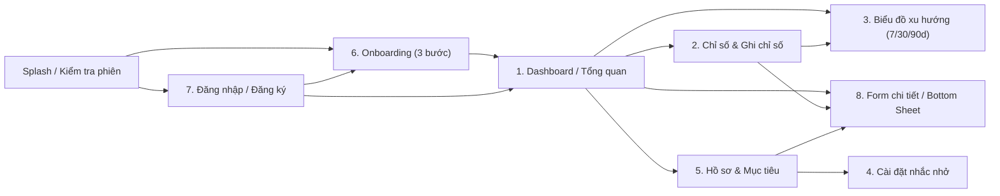

---

## Wireframe 8 màn hình chính (iPhone 393×852 / iOS 26)
> Phác thảo bố cục ban đầu từ giai đoạn thiết kế. Giao diện đã làm lại theo hướng "Calm Health" (xem các mục trên và ảnh chụp thực tế ở cuối); khi khác nhau thì lấy bản đã triển khai.


> **Ký hiệu trong wireframe:**
> - `[LG]` = Thành phần áp dụng hiệu ứng **Liquid Glass** (platform view / `.glassEffect()`)
> - `[Card]` = Thẻ nội dung phẳng `AppColors.card` (`#12293D`, `cornerRadius: 20`)
> - `[Btn]` = Nút hành động chính `AppColors.brand` (`#D93A2E`)

### 1. Dashboard / Tổng quan (`HomeScreen`)
Hiển thị nhanh tình trạng sức khỏe trong ngày ngay khi mở app, hỗ trợ Pull-to-Refresh.

```text
+------------------------------------------+
|  9:41         [ Dynamic Island ]     ||| |
|------------------------------------------|
|  THỨ TƯ, 11 THÁNG 11                     |
|  Tổng quan                       ( N )   |  <- Avatar chữ cái đầu
|                                          |
|  Hôm nay                           >     |
|  +------------------------------------+  |
|  | [Card / LG]                        |  |
|  |    ((( )))   Nước uống  1,2 /2 LÍT |  |  <- ActivityRings 3 vòng đồng tâm
|  |    (( O ))   Giấc ngủ   7,5 /8 GIỜ |  |
|  |              Thuốc      1   /2 LIỀU|  |
|  +------------------------------------+  |
|                                          |
|  Chỉ số cơ thể                     >     |
|  +----------------+  +----------------+  |
|  | [Card]         |  | [Card]         |  |
|  | o Cân nặng     |  | o BMI          |  |
|  | 66,6 kg        |  | 23,0           |  |
|  | ~~sparkline~~  |  | Bình thường    |  |
|  +----------------+  +----------------+  |
|  +----------------+  +----------------+  |
|  | [Card]         |  | [Card]         |  |
|  | o Giấc ngủ     |  | o Nước uống    |  |
|  | 7,5 giờ        |  | 1,2 lít        |  |
|  +----------------+  +----------------+  |
|                                          |
|  7 ngày qua (Nước uống)            >     |  <- Chạm mở màn Biểu đồ xu hướng
|  +------------------------------------+  |
|  | [Card]  |   |   |  ||  |   |   |   |  |
|  +------------------------------------+  |
|                                          |
|  +-------------------------------+  (+)  |  <- [LG] LiquidGlassTabBar
|  | [LG] Tổng quan|Chỉ số|Mục tiêu|Hồ sơ |     & [LG] Nút nổi interactive
|  +-------------------------------+       |
+------------------------------------------+
```

- **Điểm nhấn Liquid Glass:** Thanh tab nổi phía dưới (`LiquidGlassTabBar`) và nút thêm nhanh `+` (`interactive: true`).

---

### 2. Chỉ số & Ghi chỉ số (`MetricsScreen` + `AddScreen`)
Màn **Chỉ số** sử dụng `LiquidGlassCardGroup` cho hiệu ứng morph khi chạm mở rộng từng thẻ; chạm nút `+` để mở modal **Ghi chỉ số**.

```text
+------------------------------------------+
|  Chỉ số                             [~]  |  <- Nút mở Biểu đồ xu hướng
|                                          |
|  +------------------------------------+  |
|  | [LG] GlassCard: Nước uống          |  |  <- LiquidGlassCardGroup (morph)
|  |      1,2 lít hôm nay               |  |     Chạm để bung chi tiết 7 ngày
|  +------------------------------------+  |
|  +------------------------------------+  |
|  | [LG] GlassCard: Giấc ngủ           |  |
|  |      7 giờ 30 phút                 |  |
|  |      Trung bình 7h20 / đêm qua 7d  |  |
|  +------------------------------------+  |
|  +------------------------------------+  |
|  | [LG] GlassCard: Cân nặng           |  |
|  |      66,6 kg · BMI 23,0            |  |
|  +------------------------------------+  |
|                                          |
|  +-------------------------------+  (+)  |  <- [LG] TabBar + Floating '+'
+------------------------------------------+
```

- **Điểm nhấn Liquid Glass:** Toàn bộ nhóm thẻ [`LiquidGlassCardGroup`](../mobile/packages/liquid_glass/lib/src/card_group.dart) dùng `GlassEffectContainer` hợp nhất trên iOS 26+.

---

### 3. Biểu đồ xu hướng (`TrendChartsScreen`)
Xem diễn biến chỉ số theo 7 / 30 / 90 ngày bằng `fl_chart`, hỗ trợ chạm điểm/cột xem Tooltip.

```text
+------------------------------------------+
|  <  Xu hướng                             |
|------------------------------------------|
|  [Nước] [Bước chân] [Ngủ] [Cân nặng]     |  <- ChoiceChip chọn chỉ số
|                                          |
|  +------------------------------------+  |
|  |  [ 7 ngày ] |  30 ngày  |  90 ngày |  |  <- Segmented Control
|  +------------------------------------+  |
|                                          |
|  +------------------------------------+  |
|  | [Card] Nước uống            7 ngày |  |
|  | 11/11: 1,5 lít        <-- Tooltip  |  |
|  |                                    |  |
|  |   2.0 |       [1,5]                |  |
|  |   1.0 |   |    |    |    |    |    |  |  <- fl_chart BarChart / LineChart
|  |   0.0 +----------------------------|  |
|  |       05/11   07/11   09/11  11/11 |  |
|  +------------------------------------+  |
|                                          |
|  Tóm tắt                                 |
|  +----------+ +----------+ +----------+  |
|  | [Card]   | | [Card]   | | [Card]   |  |
|  | Trungbình| | Cao nhất | | Thấp nhất|  |
|  | 1,4 lít  | | 2,0 lít  | | 0,8 lít  |  |
|  +----------+ +----------+ +----------+  |
+------------------------------------------+
```

---

### 4. Cài đặt nhắc nhở (`RemindersScreen`)
Quản lý lịch nhắc hằng ngày (uống nước, uống thuốc, đi ngủ, bữa ăn), bật/tắt nhanh từng nhắc nhở.

```text
+------------------------------------------+
|  <  Nhắc nhở                        (+)  |
|------------------------------------------|
|  +------------------------------------+  |
|  | [Card]                             |  |
|  | (o)  08:30               [ ===O ]  |  |  <- Switch.adaptive bật/tắt
|  |      Uống nước · Đang bật          |  |     (Chạm thẻ mở BottomSheet sửa)
|  +------------------------------------+  |
|  +------------------------------------+  |
|  | [Card]                             |  |
|  | (+)  12:00               [ ===O ]  |  |
|  |      Uống thuốc · Đang bật         |  |
|  +------------------------------------+  |
|  +------------------------------------+  |
|  | [Card]                             |  |
|  | (C)  22:30               [ O=== ]  |  |
|  |      Đi ngủ · Đang tắt             |  |
|  +------------------------------------+  |
|                                          |
|  [ EmptyState nếu danh sách rỗng ]       |
|  [ + Thêm nhắc nhở ]                     |
+------------------------------------------+
```

---

### 5. Hồ sơ cá nhân & Mục tiêu (`ProfileScreen` & `GoalsScreen`)
Quản lý thông tin tài khoản, chiều cao (để tính BMI), mục tiêu ngày, mở màn Nhắc nhở và Đăng xuất.

```text
+------------------------------------------+
|  Hồ sơ                              [~]  |  <- Nút mở lại Onboarding
|------------------------------------------|
|   ( N )   Người dùng Demo                |
|           demo@healthtrack.app           |
|                                          |
|  +------------------------------------+  |
|  | [Card] Thông tin cá nhân           |  |
|  |  Họ và tên       Người dùng Demo > |  |
|  |  Giới tính              Chưa đặt > |  |
|  |  Ngày sinh              Chưa đặt > |  |
|  |  Chiều cao                170 cm > |  |
|  +------------------------------------+  |
|  +------------------------------------+  |
|  | [Card] Nhắc nhở          Cài đặt > |  |
|  +------------------------------------+  |
|                                          |
|  +------------------------------------+  |
|  |          [ Đăng xuất ]             |  |  <- OutlinedButton (danger)
|  +------------------------------------+  |
|                                          |
|  +-------------------------------+  (+)  |  <- [LG] TabBar
+------------------------------------------+
```

---

### 6. Onboarding 3 bước (`OnboardingScreen`)
Thu thập thông tin cá nhân và chỉ số ban đầu ngay sau khi người dùng mới đăng ký tài khoản.

```text
+------------------------------------------+
|  <       [===] [ ] [ ]          Bỏ qua   |  <- Thanh tiến độ 3 bước
|------------------------------------------|
|  Bước 1: Giới thiệu                      |
|      <3  Chào mừng đến HealthTrack       |
|      - Theo dõi nước, ngủ, bước chân     |
|      - Tự động tính chỉ số BMI           |
|                                          |
|  Bước 2: Thông tin cá nhân               |
|      [ Họ và tên              ]          |
|      Giới tính: (Nam) (Nữ) (Khác)        |
|      Ngày sinh: [ 01/01/2000 ]           |
|                                          |
|  Bước 3: Chỉ số ban đầu                  |
|      [ Chiều cao (cm)         ]          |
|      [ Cân nặng (kg)          ]          |
|      [Card] BMI ban đầu: 23,0 · Bình thường
|                                          |
|  +------------------------------------+  |
|  | [Btn]    Tiếp tục / Hoàn tất       |  |
|  +------------------------------------+  |
+------------------------------------------+
```

---

### 7. Đăng nhập / Đăng ký (`LoginScreen` & `RegisterScreen`)
Xác thực tài khoản gọn nhẹ, hỗ trợ Autofill iOS và hiển thị lỗi trực tiếp dưới form.

```text
+------------------------------------------+
|                                          |
|                  <3                      |  <- Icon thương hiệu (#FA114F)
|  Đăng nhập                               |
|  Theo dõi sức khỏe mỗi ngày.             |
|                                          |
|  +------------------------------------+  |
|  | [Card / AppTextField] Email        |  |
|  +------------------------------------+  |
|  +------------------------------------+  |
|  | [Card / AppTextField] Mật khẩu     |  |
|  +------------------------------------+  |
|                                          |
|     (Lỗi validation / 401 nếu có)        |
|                                          |
|  +------------------------------------+  |
|  | [Btn / PrimaryButton] Đăng nhập    |  |
|  +------------------------------------+  |
|       Chưa có tài khoản? Đăng ký         |
+------------------------------------------+
```

---

### 8. Form chi tiết / Bottom Sheet (`AddScreen` & Modal Sheets)
Ghi nhanh 6 nhóm chỉ số (Nước, Cân nặng + BMI, Ngủ, Thuốc, Bước chân, Bữa ăn) và Bottom Sheet chọn giờ iOS (`CupertinoDatePicker`) cho nhắc nhở.

```text
+------------------------------------------+
|  (X)  Thêm nhanh                         |  <- Đóng modal
|------------------------------------------|
|  (Nước) (Cân nặng) (Ngủ) (Thuốc) ...     |  <- ChoiceChip chuyển form
|                                          |
|  [ Tab Nước ]                            |
|  (150ml) (250ml) (330ml) (500ml)         |
|  +------------------------------------+  |
|  | Hoặc nhập số khác (ml)             |  |
|  +------------------------------------+  |
|                                          |
|  [ Tab Cân nặng / BMI ]                  |
|  +------------------------------------+  |
|  | [Card] BMI dự kiến: 23,5 · Bình thường
|  +------------------------------------+  |
|                                          |
|  ==== Sheet chọn giờ (Nhắc nhở) ====     |
|  +------------------------------------+  |
|  | [LG / Sheet]        ---            |  |  <- BottomSheet bo góc 24
|  |  Chọn giờ nhắc nhở            (X)  |  |
|  |       08   :   29                  |  |
|  |     > 08   :   30 <  CupertinoWheel|  |
|  |       08   :   31                  |  |
|  |  Bật nhắc nhở            [ ===O ]  |  |
|  |  [Btn]      Lưu thay đổi           |  |
|  +------------------------------------+  |
+------------------------------------------+
```

---

## Hoạt động ngoài trời (Phase 8)

Hai màn hình mới nằm ngoài thanh tab, mở từ thẻ "Hoạt động ngoài trời" ở cuối màn Thêm nhanh (`/add`). Dùng đúng quy chuẩn Calm Health: thẻ đục, số liệu dùng `AppFonts.number` (chữ số đều nhau), Liquid Glass chỉ cho lớp nổi và nút.

### Màn ghi hoạt động (`RecordScreen`, `/record?sport=run|walk|ride`)
- **Bản đồ Apple Maps toàn màn** (`RouteMapView`, platform view `healthtrack/route_map`): đường đi đổi màu theo tốc độ từ cam đậm sang vàng thương hiệu và vàng nhạt, camera bám người dùng. Bản không phải iPhone vẽ bản dự phòng bằng `RoutePainter`.
- **Thanh trên:** nút đóng, chip tín hiệu GPS (Chưa có GPS, GPS yếu, khá, tốt; có màu và chữ), nút đổi kiểu bản đồ. Khi người dùng kéo bản đồ đi chỗ khác, hiện nút "về vị trí của tôi".
- **Tấm kính số liệu** (`LiquidGlass`, nền tối ở Dark Mode): đồng hồ lớn 64 pt, quãng đường (km), nhịp (phút/km; đạp xe hiện km/h).
- **Điều khiển:**
  - Trước khi ghi: ba nút chọn môn tròn (chạy, đi bộ, đạp xe) và nút "Bắt đầu" (`GlassButton.prominent`, vàng).
  - Bấm Bắt đầu: đếm ngược 3, 2, 1 toàn màn kèm haptic; chạm để hủy.
  - Đang ghi: nút Tạm dừng/Tiếp tục tròn lớn, nút Kết thúc **nhấn giữ khoảng 1,2 giây** (vòng tiến trình đỏ) để tránh bấm nhầm. Người dùng trình đọc màn hình chạm hai lần là kết thúc.
  - Tự tạm dừng khi đứng yên 10 giây, hiện dòng "Tự tạm dừng vì bạn đứng yên".
- **Quyền vị trí:** chưa hỏi thì có nút "Cho phép vị trí"; bị từ chối thì "Mở Cài đặt"; đang ở quyền "Khi dùng app" thì nhắc chọn "Luôn luôn" để ghi được khi khóa máy.
- **An toàn dữ liệu:** lưu bản nháp mỗi 20 giây; mở lại màn sau khi app bị tắt giữa chừng thì hỏi lưu hay bỏ. Thoát khi đang ghi có hộp xác nhận. Buổi dưới 20 m không được lưu.

### Trang tổng kết (`WorkoutSummaryScreen`, `/workout/:id`)
- Tên, môn, ngày giờ; **ảnh bản đồ tĩnh** (`MKMapSnapshotter`, theo sáng/tối) với đường đi đổi màu theo tốc độ, tỉ lệ 4:3. Không có mạng hoặc không phải iPhone thì vẽ bản dự phòng.
- Quãng đường 56 pt, lưới số liệu: thời gian, nhịp trung bình (hoặc tốc độ), độ cao leo, năng lượng.
- **Từng km:** thẻ đục, mỗi km một thanh (dài hơn là nhanh hơn), km nhanh nhất tô vàng đậm.
- **Biểu đồ** nhịp (hoặc tốc độ) và độ cao theo quãng đường, vẽ bằng `CustomPainter` (đường vàng với vùng tô nhạt).
- Nút "Chia sẻ" xuất ảnh bản đồ qua share sheet (bộ ảnh ghép của #245 sẽ thay bước này); nút thùng rác xóa buổi tập, có xác nhận.
- Trình đọc màn hình: mỗi số liệu, mỗi km và mỗi biểu đồ có nhãn đọc được (ví dụ "Km 3, nhịp 5:21, nhanh nhất").

### Live Activity buổi tập (màn hình khóa và Dynamic Island)
Khi đang ghi, số liệu hiện trên màn hình khóa và Dynamic Island (iOS 16.2 trở lên), thuộc cùng Widget Extension `HealthTrackWidget` với widget màn hình chính và Live Activity uống nước.
- **Nội dung:** biểu tượng môn, trạng thái (Đang ghi, Đã tạm dừng), thời gian vận động, quãng đường (km), nhịp (phút/km; đạp xe hiện km/h). Dynamic Island: biểu tượng và quãng đường khi thu gọn; thời gian, quãng đường và nhịp khi mở rộng.
- **Cập nhật:** app gửi số liệu mỗi 5 giây và ngay khi tạm dừng hoặc tiếp tục. Đồng hồ trên màn khóa tự đếm bằng `Text(_, style: .timer)` nên không cần gửi mỗi giây, đỡ tốn pin. Đang tạm dừng thì đồng hồ đứng yên.
- **Dữ liệu cũ:** quá 60 giây không có cập nhật (ví dụ app bị hệ thống tắt) thì hệ thống đánh dấu "cũ" và màn khóa hiện "Mở app để cập nhật" thay vì đứng yên như vẫn đang chạy.
- **Kết thúc:** tự tắt khi kết thúc, bỏ buổi tập hoặc đóng màn ghi.
- **Giới hạn của bản cài lại (sideload):** Live Activity cần Widget Extension và App Group `group.vn.edu.vku.healthtrack` được ký đúng. Khi cài lại bằng công cụ ký lại (ví dụ AltStore, Sideloadly) bằng Apple ID miễn phí, App Group và extension có thể bị gỡ hoặc đổi định danh, khi đó Live Activity không hiện; app vẫn ghi buổi tập bình thường vì mọi lỗi Live Activity đều bị bỏ qua. Người dùng cũng có thể tắt Live Activity trong Cài đặt của iPhone. Chưa thử trên iPhone thật; trên Simulator chỉ xác nhận qua log hệ thống rằng Live Activity được tạo và nạp nội dung.

Dữ liệu và API: xem [14-hop-dong-du-lieu-workout.md](14-hop-dong-du-lieu-workout.md).

## Tổng hợp vị trí áp dụng Liquid Glass

| Vị trí | Widget | Áp dụng Liquid Glass? | Ghi chú |
|---|---|---|---|
| Thanh điều hướng dưới | `LiquidGlassTabBar` | **Có** (`GlassEffectContainer`) | Nổi cố định trên 4 tab chính |
| Nút thêm nhanh `+` giữa thanh, nhô lên | `LiquidGlassTabBar` (`onAdd`) | **Có** (`interactive: true`) | Phản hồi chạm đàn hồi iOS 26 |
| Nút icon tròn, nút chính, Hủy/Lưu | `GlassIconButton`, `GlassButton` | **Có** (UIButton `.glass()`/`.prominentGlass()`) | Nút điều hướng và nút hành động chính; hàng trong danh sách không dùng |
| Nhóm thẻ màn Chỉ số | `LiquidGlassCardGroup` | **Không** (đã chuyển sang `MetricCard` đục) | Widget còn trong package `liquid_glass` nhưng app không dùng |
| Tấm số liệu màn ghi hoạt động | `LiquidGlass` (nền tối) | **Có** | Lớp nổi trên bản đồ toàn màn, không phải thẻ nội dung |
| Form sheet, action sheet | `showFormSheet`, `CupertinoActionSheet` | **Không** | Bề mặt đục; action sheet do hệ thống vẽ |
| Thẻ nội dung | `AppCard`, `MetricCard`, `SettingsGroup` | **Không** (màu `card`) | Tối ưu GPU/FPS theo Apple HIG |

## Ảnh chụp thực tế
iPhone 13, iOS 27.2 Simulator, chụp bằng `xcrun simctl io booted screenshot`.

| Tổng quan, tối | Tổng quan, sáng |
|---|---|
| 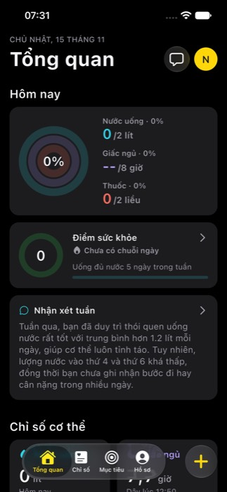 | 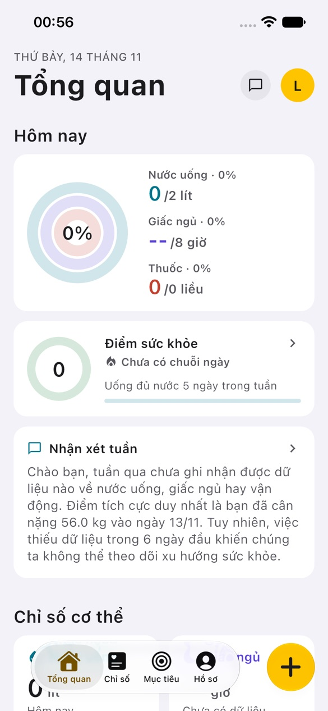 |

| Chỉ số, tối | Mục tiêu, tối | Hồ sơ, tối |
|---|---|---|
| 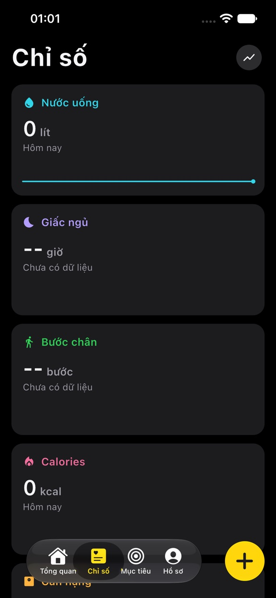 | 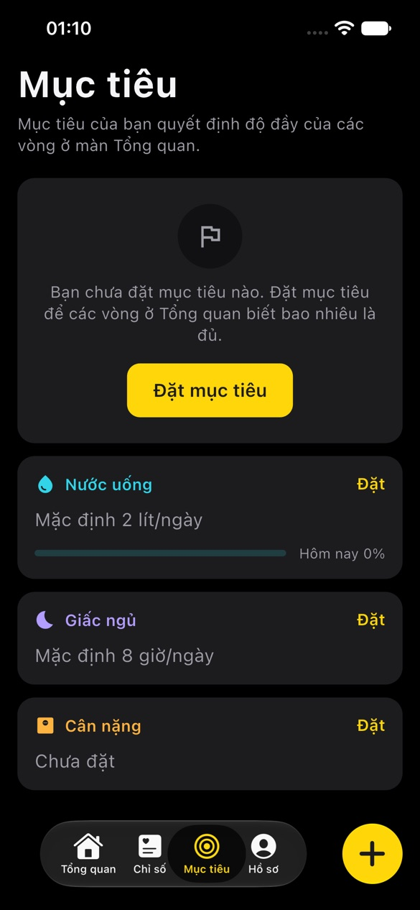 | 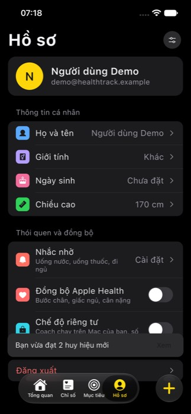 |

Nút Liquid Glass (Hủy/Lưu, nút chính, đang tải, nút tròn), skeleton kiểu iOS, icon ứng dụng trên màn hình chính và splash chế độ tối:

| Nút kính | Skeleton | App icon | Splash |
|---|---|---|---|
| 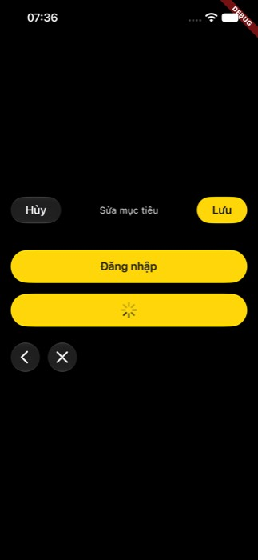 | 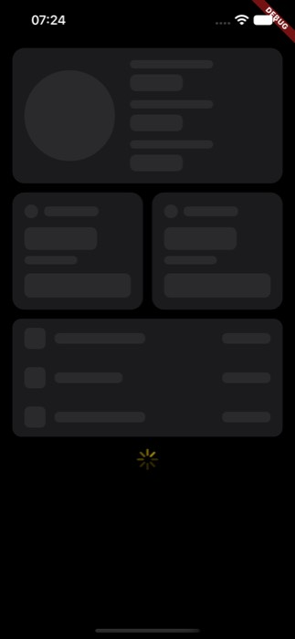 | 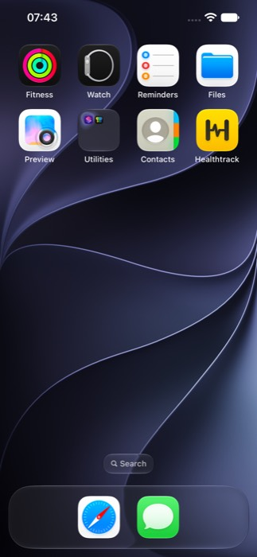 | 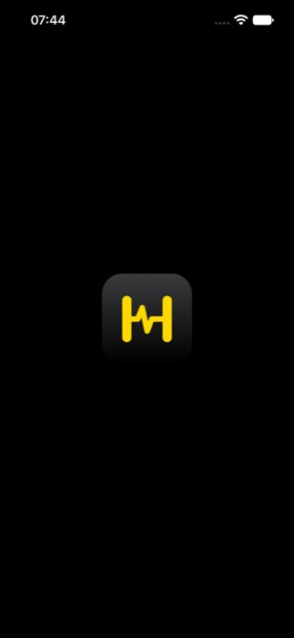 |

Sheet sửa mục tiêu (báo lỗi ngoài khoảng, Lưu tắt), action sheet giới tính kiểu iOS ở chế độ sáng, Mục tiêu ở cỡ chữ lớn (`accessibility-large`) và Coach:

| Sheet mục tiêu | Action sheet | Chữ lớn | Coach |
|---|---|---|---|
| 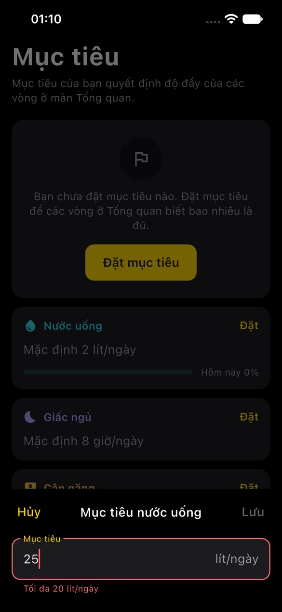 | 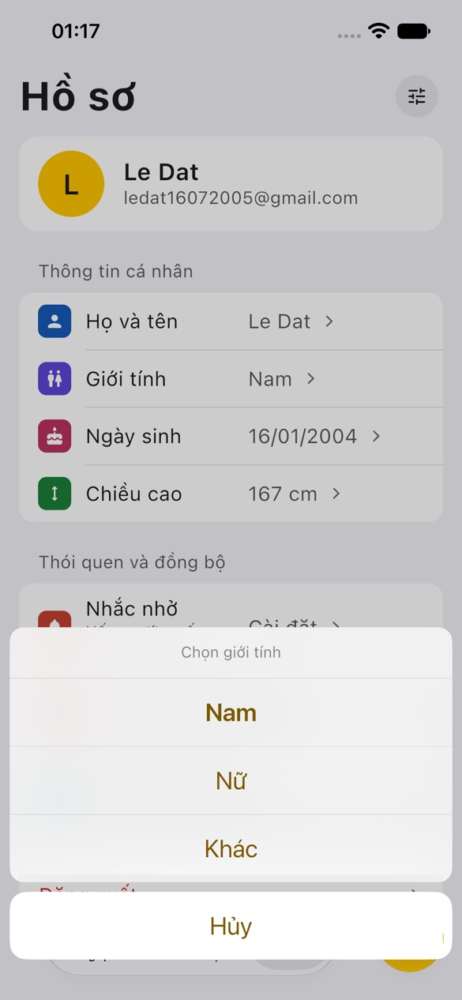 | 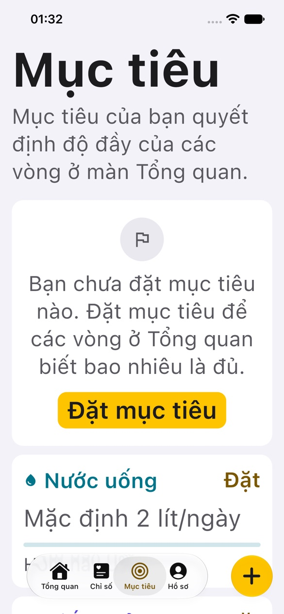 | 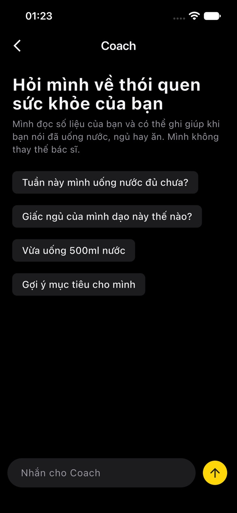 |

## Kiểm tra giao diện
- **Tương phản:** `test/theme_accessibility_test.dart` kiểm mọi màu chữ và màu nhấn >= 4.5:1 ở cả hai chế độ.
- **Kích thước và cỡ chữ:** `test/responsive_matrix_test.dart` dựng 5 màn chính ở 320x568, 375x667, 390x844, 430x932, chữ 1x và 2x, sáng và tối, không được tràn.
- **Form:** `test/settings_form_sheet_test.dart`, `test/goals_edit_test.dart`, `test/add_medication_test.dart`.
- **Golden:** `test/goldens/foundation_widgets_*.png` sinh trên Linux bằng workflow "Update goldens" (xem docs/09).
- **Chụp trên Simulator:** `xcrun simctl ui booted appearance light|dark` đổi sáng/tối, `xcrun simctl ui booted content_size accessibility-large` đổi cỡ chữ.
