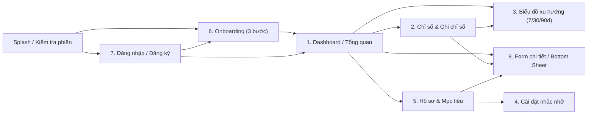

# Thiết kế giao diện

## Hướng thẩm mỹ: "Mực biển"
**Chủ đề:** nhật ký sức khỏe hằng ngày của người trẻ Việt Nam, mở app vài lần mỗi ngày để ghi nhanh và nhìn lại. Việc chính của giao diện là cho thấy hôm nay mình đã làm được bao nhiêu chỉ bằng một cái nhìn.

**Cảm giác:** bình tĩnh như mặt nước ban đêm, con số nổi bật như đèn trên bảng điều khiển. Nền xanh biển đêm thay cho đen tuyền, mỗi chỉ số là một sắc riêng lấy từ vật thật: nước (ngọc lam), giấc ngủ (tím phấn), bước chân (cam hổ phách), cân nặng (vàng nắng), bữa ăn (hồng cánh sen), thuốc (san hô).

**Điểm nhấn duy nhất:** vòng hoạt động ở Tổng quan, có gradient và vầng sáng nhẹ. Mọi thứ xung quanh giữ yên tĩnh: thẻ phẳng, không viền, không bóng đổ lặp lại.

**Đã bỏ khỏi bản cũ:** nền đen tuyền kèm màu nhấn neon (kiểu mặc định của app thể dục), nhãn chữ HOA tràn lan, thẻ nào cũng bo giống nhau.

### Bảng màu (Dark Mode là mặc định)
| Vai trò | Tên | Dark | Light |
|---|---|---|---|
| Nền | Mực biển | `#0A1A2A` | `#EEF4F3` |
| Thẻ | Nước sâu | `#12293D` | `#FFFFFF` |
| Thẻ nâng | Sóng | `#1B3A55` | `#DCE8E6` |
| Chữ chính | Sương | `#F2F7F5` | `#0C2233` |
| Chữ phụ | Mây | `#9FB6C4` | `#3F5A6B` |
| Thương hiệu, nút nổi | Đỏ son | `#D93A2E` | `#C2412F` |

| Chỉ số | Dark | Light |
|---|---|---|
| Bước chân (cam hổ phách) | `#FF8A4C` | `#B2470F` |
| Thuốc, vòng thứ nhất (san hô) | `#FF6F61` | `#C2412F` |
| Giấc ngủ (tím phấn) | `#A08CFF` | `#5B45D6` |
| Nước uống (ngọc lam) | `#38D6C9` | `#00796F` |
| Cân nặng (vàng nắng) | `#E8C547` | `#8A6A00` |
| Bữa ăn (hồng cánh sen) | `#F26D9B` | `#B8325F` |
| Thuốc, thẻ (xanh trời) | `#5AA9FF` | `#1559B8` |

Mọi màu chữ và màu nhấn đạt tương phản >= 4.5:1 trên nền và thẻ ở cả hai chế độ (đã kiểm bằng công thức WCAG). Chữ trắng trên nút thương hiệu đạt 4.57:1.

### Kiểu chữ
- **Tiêu đề và số liệu:** Bricolage Grotesque (OFL, có đủ dấu tiếng Việt), font biến thiên đóng gói tại `mobile/assets/fonts/`. Tiêu đề dùng độ đậm 700 đến 780 và hơi hẹp (`wdth` 90 đến 95); số liệu dùng chữ số đều bề rộng (`tabularFigures`) để không nhảy khi đếm lên.
- **Chữ thân:** font hệ thống của iOS, để Dynamic Type và VoiceOver hoạt động chuẩn.
- **Câu chữ:** chữ thường theo câu, không dùng chữ HOA cho nhãn và đơn vị. Nút ghi đúng việc sẽ xảy ra ("Thêm nước", "Lưu").

### Chuyển động
Chỉ dùng để báo điều gì vừa thay đổi: vòng đầy lên khi mở màn Tổng quan, số đếm lên khi giá trị đổi, rung nhẹ (haptic) khi ghi dữ liệu xong. Không dùng hiệu ứng trượt và mờ dần cho mỗi thẻ. Mọi thời lượng lấy từ `AppMotion`, và bằng 0 khi người dùng bật Giảm chuyển động.

## Nguyên tắc
- Giao diện chính là **iPhone**, dùng **Liquid Glass của iOS 26** cho lớp nổi.
- **Quy chuẩn Liquid Glass:** chỉ dùng cho lớp điều hướng nổi và nhóm thẻ tương tác nổi bật (thanh tab dưới, nút thêm nhanh nổi `+`, nhóm thẻ `LiquidGlassCardGroup`, modal sheet nổi), **không** phủ kính cho toàn bộ danh sách cuộn dài để giữ hiệu năng (tránh tạo nhiều platform view `UiKitView`) và giữ phân cấp thị giác rõ ràng. Thẻ nội dung thông thường dùng bề mặt phẳng `AppColors.card`.
- View kính native dùng `dark: true` ở Dark Mode để đồng bộ nền.
- Toàn bộ màu sắc, bo góc, chuyển động và kiểu chữ lấy từ `mobile/lib/core/theme.dart` (không hard-code trong màn hình).
- Hỗ trợ Dynamic Type (co giãn font chữ), VoiceOver (`Semantics` đầy đủ cho nút, thẻ, tiêu đề, thông báo lỗi) và hiển thị chuẩn từ **iPhone SE (`375x667`)** đến **iPhone Pro Max (`430x932`)**.

## Thành phần dùng chung (`mobile/lib/widgets/`)
- `ActivityRings`: các vòng đồng tâm có hoạt ảnh chạy lên tiến độ; vòng đầu ở ngoài cùng.
- `MetricCard`: tên có màu nhấn, số lớn, đường xu hướng sparkline nhỏ.
- `SectionHeader`: tiêu đề mục chữ đậm kèm mũi tên điều hướng.
- `AppTextField`, `PrimaryButton`, `ErrorText`: bộ thành phần form đồng bộ bo góc 14 và validation.

## Widget `LiquidGlass`
```dart
LiquidGlass(
  cornerRadius: 24,
  tint: AppColors.brand.withValues(alpha: 0.15),
  interactive: true,
  child: ...,
)
```
Trên iOS 26+ dùng lớp kính SwiftUI `.glassEffect()` qua platform view; nơi khác dùng `BackdropFilter` dự phòng.

## Danh sách màn hình & Luồng điều hướng



---

## Wireframe 8 màn hình chính (iPhone 393×852 / iOS 26)

> **Ký hiệu trong wireframe:**
> - `[LG]` = Thành phần áp dụng hiệu ứng **Liquid Glass** (platform view / `.glassEffect()`)
> - `[Card]` = Thẻ nội dung phẳng `AppColors.card` (`#12293D`, `cornerRadius: 20`)
> - `[Btn]` = Nút hành động chính `AppColors.brand` (`#D93A2E`)

### 1. Dashboard / Tổng quan (`HomeScreen`)
Hiển thị nhanh tình trạng sức khỏe trong ngày ngay khi mở app, hỗ trợ Pull-to-Refresh.

```text
+------------------------------------------+
|  9:41         [ Dynamic Island ]     ||| |
|------------------------------------------|
|  THỨ TƯ, 11 THÁNG 11                     |
|  Tổng quan                       ( N )   |  <- Avatar chữ cái đầu
|                                          |
|  Hôm nay                           >     |
|  +------------------------------------+  |
|  | [Card / LG]                        |  |
|  |    ((( )))   Nước uống  1,2 /2 LÍT |  |  <- ActivityRings 3 vòng đồng tâm
|  |    (( O ))   Giấc ngủ   7,5 /8 GIỜ |  |
|  |              Thuốc      1   /2 LIỀU|  |
|  +------------------------------------+  |
|                                          |
|  Chỉ số cơ thể                     >     |
|  +----------------+  +----------------+  |
|  | [Card]         |  | [Card]         |  |
|  | o Cân nặng     |  | o BMI          |  |
|  | 66,6 kg        |  | 23,0           |  |
|  | ~~sparkline~~  |  | Bình thường    |  |
|  +----------------+  +----------------+  |
|  +----------------+  +----------------+  |
|  | [Card]         |  | [Card]         |  |
|  | o Giấc ngủ     |  | o Nước uống    |  |
|  | 7,5 giờ        |  | 1,2 lít        |  |
|  +----------------+  +----------------+  |
|                                          |
|  7 ngày qua (Nước uống)            >     |  <- Chạm mở màn Biểu đồ xu hướng
|  +------------------------------------+  |
|  | [Card]  |   |   |  ||  |   |   |   |  |
|  +------------------------------------+  |
|                                          |
|  +-------------------------------+  (+)  |  <- [LG] LiquidGlassTabBar
|  | [LG] Tổng quan|Chỉ số|Mục tiêu|Hồ sơ |     & [LG] Nút nổi interactive
|  +-------------------------------+       |
+------------------------------------------+
```

- **Điểm nhấn Liquid Glass:** Thanh tab nổi phía dưới (`LiquidGlassTabBar`) và nút thêm nhanh `+` (`interactive: true`).

---

### 2. Chỉ số & Ghi chỉ số (`MetricsScreen` + `AddScreen`)
Màn **Chỉ số** sử dụng `LiquidGlassCardGroup` cho hiệu ứng morph khi chạm mở rộng từng thẻ; chạm nút `+` để mở modal **Ghi chỉ số**.

```text
+------------------------------------------+
|  Chỉ số                             [~]  |  <- Nút mở Biểu đồ xu hướng
|                                          |
|  +------------------------------------+  |
|  | [LG] GlassCard: Nước uống          |  |  <- LiquidGlassCardGroup (morph)
|  |      1,2 lít hôm nay               |  |     Chạm để bung chi tiết 7 ngày
|  +------------------------------------+  |
|  +------------------------------------+  |
|  | [LG] GlassCard: Giấc ngủ           |  |
|  |      7 giờ 30 phút                 |  |
|  |      Trung bình 7h20 / đêm qua 7d  |  |
|  +------------------------------------+  |
|  +------------------------------------+  |
|  | [LG] GlassCard: Cân nặng           |  |
|  |      66,6 kg · BMI 23,0            |  |
|  +------------------------------------+  |
|                                          |
|  +-------------------------------+  (+)  |  <- [LG] TabBar + Floating '+'
+------------------------------------------+
```

- **Điểm nhấn Liquid Glass:** Toàn bộ nhóm thẻ [`LiquidGlassCardGroup`](../mobile/packages/liquid_glass/lib/src/card_group.dart) dùng `GlassEffectContainer` hợp nhất trên iOS 26+.

---

### 3. Biểu đồ xu hướng (`TrendChartsScreen`)
Xem diễn biến chỉ số theo 7 / 30 / 90 ngày bằng `fl_chart`, hỗ trợ chạm điểm/cột xem Tooltip.

```text
+------------------------------------------+
|  <  Xu hướng                             |
|------------------------------------------|
|  [Nước] [Bước chân] [Ngủ] [Cân nặng]     |  <- ChoiceChip chọn chỉ số
|                                          |
|  +------------------------------------+  |
|  |  [ 7 ngày ] |  30 ngày  |  90 ngày |  |  <- Segmented Control
|  +------------------------------------+  |
|                                          |
|  +------------------------------------+  |
|  | [Card] Nước uống            7 ngày |  |
|  | 11/11: 1,5 lít        <-- Tooltip  |  |
|  |                                    |  |
|  |   2.0 |       [1,5]                |  |
|  |   1.0 |   |    |    |    |    |    |  |  <- fl_chart BarChart / LineChart
|  |   0.0 +----------------------------|  |
|  |       05/11   07/11   09/11  11/11 |  |
|  +------------------------------------+  |
|                                          |
|  Tóm tắt                                 |
|  +----------+ +----------+ +----------+  |
|  | [Card]   | | [Card]   | | [Card]   |  |
|  | Trungbình| | Cao nhất | | Thấp nhất|  |
|  | 1,4 lít  | | 2,0 lít  | | 0,8 lít  |  |
|  +----------+ +----------+ +----------+  |
+------------------------------------------+
```

---

### 4. Cài đặt nhắc nhở (`RemindersScreen`)
Quản lý lịch nhắc hằng ngày (uống nước, uống thuốc, đi ngủ, bữa ăn), bật/tắt nhanh từng nhắc nhở.

```text
+------------------------------------------+
|  <  Nhắc nhở                        (+)  |
|------------------------------------------|
|  +------------------------------------+  |
|  | [Card]                             |  |
|  | (o)  08:30               [ ===O ]  |  |  <- Switch.adaptive bật/tắt
|  |      Uống nước · Đang bật          |  |     (Chạm thẻ mở BottomSheet sửa)
|  +------------------------------------+  |
|  +------------------------------------+  |
|  | [Card]                             |  |
|  | (+)  12:00               [ ===O ]  |  |
|  |      Uống thuốc · Đang bật         |  |
|  +------------------------------------+  |
|  +------------------------------------+  |
|  | [Card]                             |  |
|  | (C)  22:30               [ O=== ]  |  |
|  |      Đi ngủ · Đang tắt             |  |
|  +------------------------------------+  |
|                                          |
|  [ EmptyState nếu danh sách rỗng ]       |
|  [ + Thêm nhắc nhở ]                     |
+------------------------------------------+
```

---

### 5. Hồ sơ cá nhân & Mục tiêu (`ProfileScreen` & `GoalsScreen`)
Quản lý thông tin tài khoản, chiều cao (để tính BMI), mục tiêu ngày, mở màn Nhắc nhở và Đăng xuất.

```text
+------------------------------------------+
|  Hồ sơ                              [~]  |  <- Nút mở lại Onboarding
|------------------------------------------|
|   ( N )   Người dùng Demo                |
|           demo@healthtrack.app           |
|                                          |
|  +------------------------------------+  |
|  | [Card] Thông tin cá nhân           |  |
|  |  Họ và tên       Người dùng Demo > |  |
|  |  Giới tính              Chưa đặt > |  |
|  |  Ngày sinh              Chưa đặt > |  |
|  |  Chiều cao                170 cm > |  |
|  +------------------------------------+  |
|  +------------------------------------+  |
|  | [Card] Nhắc nhở          Cài đặt > |  |
|  +------------------------------------+  |
|                                          |
|  +------------------------------------+  |
|  |          [ Đăng xuất ]             |  |  <- OutlinedButton (danger)
|  +------------------------------------+  |
|                                          |
|  +-------------------------------+  (+)  |  <- [LG] TabBar
+------------------------------------------+
```

---

### 6. Onboarding 3 bước (`OnboardingScreen`)
Thu thập thông tin cá nhân và chỉ số ban đầu ngay sau khi người dùng mới đăng ký tài khoản.

```text
+------------------------------------------+
|  <       [===] [ ] [ ]          Bỏ qua   |  <- Thanh tiến độ 3 bước
|------------------------------------------|
|  Bước 1: Giới thiệu                      |
|      <3  Chào mừng đến HealthTrack       |
|      - Theo dõi nước, ngủ, bước chân     |
|      - Tự động tính chỉ số BMI           |
|                                          |
|  Bước 2: Thông tin cá nhân               |
|      [ Họ và tên              ]          |
|      Giới tính: (Nam) (Nữ) (Khác)        |
|      Ngày sinh: [ 01/01/2000 ]           |
|                                          |
|  Bước 3: Chỉ số ban đầu                  |
|      [ Chiều cao (cm)         ]          |
|      [ Cân nặng (kg)          ]          |
|      [Card] BMI ban đầu: 23,0 · Bình thường
|                                          |
|  +------------------------------------+  |
|  | [Btn]    Tiếp tục / Hoàn tất       |  |
|  +------------------------------------+  |
+------------------------------------------+
```

---

### 7. Đăng nhập / Đăng ký (`LoginScreen` & `RegisterScreen`)
Xác thực tài khoản gọn nhẹ, hỗ trợ Autofill iOS và hiển thị lỗi trực tiếp dưới form.

```text
+------------------------------------------+
|                                          |
|                  <3                      |  <- Icon thương hiệu (#FA114F)
|  Đăng nhập                               |
|  Theo dõi sức khỏe mỗi ngày.             |
|                                          |
|  +------------------------------------+  |
|  | [Card / AppTextField] Email        |  |
|  +------------------------------------+  |
|  +------------------------------------+  |
|  | [Card / AppTextField] Mật khẩu     |  |
|  +------------------------------------+  |
|                                          |
|     (Lỗi validation / 401 nếu có)        |
|                                          |
|  +------------------------------------+  |
|  | [Btn / PrimaryButton] Đăng nhập    |  |
|  +------------------------------------+  |
|       Chưa có tài khoản? Đăng ký         |
+------------------------------------------+
```

---

### 8. Form chi tiết / Bottom Sheet (`AddScreen` & Modal Sheets)
Ghi nhanh 6 nhóm chỉ số (Nước, Cân nặng + BMI, Ngủ, Thuốc, Bước chân, Bữa ăn) và Bottom Sheet chọn giờ iOS (`CupertinoDatePicker`) cho nhắc nhở.

```text
+------------------------------------------+
|  (X)  Thêm nhanh                         |  <- Đóng modal
|------------------------------------------|
|  (Nước) (Cân nặng) (Ngủ) (Thuốc) ...     |  <- ChoiceChip chuyển form
|                                          |
|  [ Tab Nước ]                            |
|  (150ml) (250ml) (330ml) (500ml)         |
|  +------------------------------------+  |
|  | Hoặc nhập số khác (ml)             |  |
|  +------------------------------------+  |
|                                          |
|  [ Tab Cân nặng / BMI ]                  |
|  +------------------------------------+  |
|  | [Card] BMI dự kiến: 23,5 · Bình thường
|  +------------------------------------+  |
|                                          |
|  ==== Sheet chọn giờ (Nhắc nhở) ====     |
|  +------------------------------------+  |
|  | [LG / Sheet]        ---            |  |  <- BottomSheet bo góc 24
|  |  Chọn giờ nhắc nhở            (X)  |  |
|  |       08   :   29                  |  |
|  |     > 08   :   30 <  CupertinoWheel|  |
|  |       08   :   31                  |  |
|  |  Bật nhắc nhở            [ ===O ]  |  |
|  |  [Btn]      Lưu thay đổi           |  |
|  +------------------------------------+  |
+------------------------------------------+
```

---

## Tổng hợp vị trí áp dụng Liquid Glass

| Vị trí | Widget | Áp dụng Liquid Glass? | Ghi chú |
|---|---|---|---|
| Thanh điều hướng dưới | `LiquidGlassTabBar` | **Có** (`GlassEffectContainer`) | Nổi cố định trên 4 tab chính |
| Nút thêm nhanh nổi `+` | `LiquidGlassTabBar` (`onAdd`) | **Có** (`interactive: true`) | Phản hồi chạm đàn hồi iOS 26 |
| Nhóm thẻ màn Chỉ số | `LiquidGlassCardGroup` | **Có** (`morph` animation) | Mở rộng chi tiết từng thẻ chỉ số |
| Modal Sheet nổi (tùy chọn) | `LiquidGlass` / BottomSheet | **Có** | Dùng `tint` tối giữ contrast `>= 4.5:1` |
| Thẻ trong danh sách cuộn dài | `AppCard`, `MetricCard`, `ListTile` | **Không** (dùng `AppColors.card`) | Tối ưu GPU/FPS theo Apple HIG |

## Ảnh chụp thực tế
iPhone 13, iOS 27.2 Simulator.

Tổng quan (Activity Rings, thẻ chỉ số, thanh tab Liquid Glass):


Chỉ số (nhóm thẻ Liquid Glass, chạm để mở rộng và morph):


