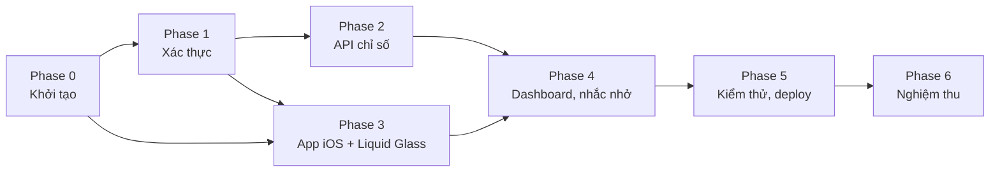

# Phụ thuộc task và đường găng (CPM)

Dự án không ràng buộc theo lịch. Thứ tự làm việc xác định bởi phụ thuộc giữa các task, theo dõi bằng Velocity (story point hoàn thành mỗi lượt) và biểu đồ Burndown trên GitHub Projects.

**Đường găng:** Phase 0 → 1 → 2 → 4 → 5 → 6. Phase 3 (giao diện) làm song song với Phase 2 và nối vào Phase 4.

Mỗi task ghi phụ thuộc trong mục "Phụ thuộc" của issue. Cần bổ sung Story Points qua Planning Poker và Velocity thực tế khi các lượt làm việc hoàn thành.
